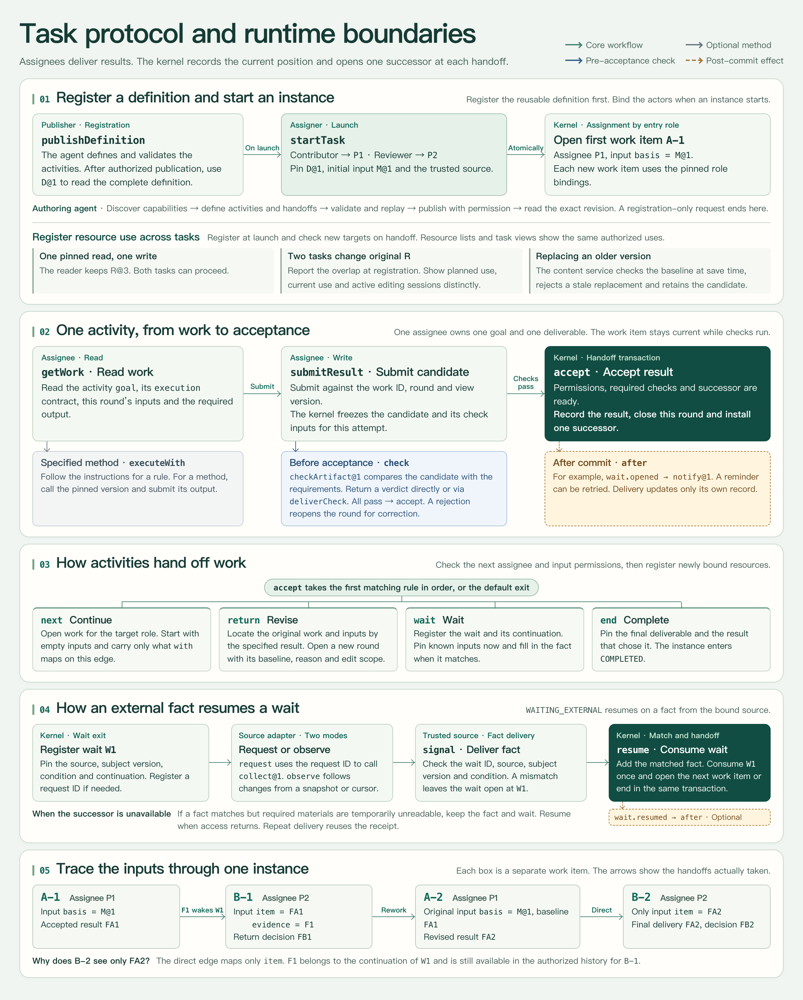
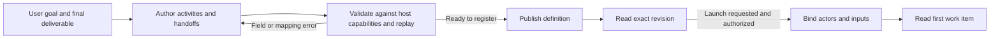

# Task Interaction Protocol 1.0

English · [简体中文](README.zh-CN.md)

A task definition says who owes a deliverable, what counts as acceptance, and where the work goes next. A task service registers the definition and records each submission, decision and handoff. People and agents use the same authorized operations. Implementers choose the language, database, transport and model.

For example, a writer submits a conclusion and says whether it needs external confirmation. If it does, the service waits for a trusted source. A reviewer can send the conclusion back with a reason or accept it as the final deliverable. This is a runnable definition with two activities, one conditional wait and an end route. [Task JSON](examples/en/review.task.json) · [Definition schema](definition.schema.json) · [Message schema](messages.schema.json)

[Run the local example](#local-walkthrough) · [Integrate the protocol](#integration) · [Detailed design and acceptance cases](docs/protocol-and-runtime-boundaries.md)

<details>
<summary>View the protocol diagram</summary>



Open the [interactive diagram](docs/assets/task-system-core-protocol.html) from a local checkout to try the routes, or view the [full-resolution image](docs/assets/task-system-core-protocol.png).

</details>

Presentation belongs to the application. `readDefinition` returns registered requirements, `getWork` exposes the permitted instance state and actions, and `submitResult` takes a candidate for the current round. A service-only integration can prove registration by reading the exact revision, execution by reading work and receipts, and completion by reading both the final deliverable and the decision that selected it.

<a id="integration"></a>

## Integrate with your system

Give your coding agent the integration Skill and access to this checkout. It guides the agent from an existing task or assignment through registration, authorized work, submission and readback in your application. For example, ask “Use `$task-protocol-integration` to connect our existing review queue. Show me how the reviewer retrieves the accepted revision after a restart.” [English Skill](skills/task-protocol-integration/SKILL.md) · [中文译文](skills/task-protocol-integration/SKILL.zh-CN.md)

For Codex, run these commands from the root of the **application you are integrating**. They clone the protocol next to the application and link the Skill to its matching schemas, examples and replay tools. If you already have a checkout, set `protocol_dir` to its absolute path and start at `mkdir`. You can also give an agent the path to `SKILL.md` directly.

```sh
protocol_dir="$(dirname "$(pwd -P)")/task-interaction-protocol"
git clone https://github.com/alcheme-labs/task-interaction-protocol.git "$protocol_dir"
mkdir -p .agents/skills
ln -s "$protocol_dir/skills/task-protocol-integration" .agents/skills/
```

Two companion protocols can help where your application needs them.

- **Building a standalone server.** ServiceSeed (formerly ServerAgent) covers creating, connecting and maintaining a service under its own contract and permissions. [ServiceSeed on GitHub](https://github.com/alcheme-labs/ServiceSeed)
- **Connecting a user-owned agent.** Agent Bridge Spec (`local-agent-bridge`) covers the connection and authorization between an application and a local or remote agent. Route task operations through the task service so its permissions and receipts apply to both people and agents. [Agent Bridge Spec on GitHub](https://github.com/alcheme-labs/agent-bridge-spec)

## 1. From a request to a registered definition

| Question for the authoring agent | What to write or call | What to verify |
| --- | --- | --- |
| What must be delivered, and who can accept it? | Write the overall goal and final deliverable. Map each required item, check, external condition and rework limit to a field or rule. | Identify the accepted result that supplies the deliverable and the decision that ends the instance. |
| Where does responsibility change hands? | Create an activity for each independent submission. Give it a role, goal, input sources, execution instructions, output, acceptance conditions and an exit for each outcome. | Follow each path to an end. For a return, identify the result to revise and the fields open to change. |
| Can this host run it? | Use `describeTaskProtocol` to discover authorized capabilities. Give rule-based activities their instructions. Resolve any specified method, resource use or external source. | Each dependency has an authorized binding. Resolve people with the same display name to the intended principal. |
| Does the definition express the request? | Call `validateDefinition`. Exercise normal and exceptional paths in isolation with concrete submissions, events and expected outcomes. | Explain why a candidate was rejected or returned and what a retry will do. Use field paths to correct structure or mapping errors. |
| Did the caller ask to register or also to start? | With registration permission, call `publishDefinition` and use its returned revision with `readDefinition`. Call `startTask` only when launch was requested and authorized. | Registration yields the exact document. Launch also yields an instance ID, and the first assignee can read their goal, inputs and deliverable. |



**Choosing an activity, check, wait or notification**

| Phrase in the request | Representation | Reason |
| --- | --- | --- |
| “The reviewer decides whether to adopt the conclusion.” | A separate `review` activity that approves or returns with a reason | A different responsibility produces a traceable decision. |
| “When submitting, say whether external confirmation is needed.” | A required `bool` output on the current activity, read by the route as `out.confirm` | The assignee provides it with the candidate. |
| “Check that the file qualifies before accepting it.” | Reference the registered check method in `checks` | The checker judges this candidate attempt before the kernel accepts it. |
| “Continue once the receipt arrives.” / “Also send a reminder.” | Bind the authoritative source with `wait`. Subscribe to the committed event with `after` for the reminder. | A wait needs a source, subject and condition. The delivery receipt for a reminder records only the notification. |

The agent can generate role and field names, sequential links and default rule instructions from the activity goal. “A different person must acknowledge the handover” requires `"distinctRoles":[["writer","reviewer"]]`. Two role names alone can resolve to one principal. When “approved” could change the final deliverable, two people could be the named reviewer, or overwriting an original and submitting a copy have different effects, check the request and the authorized catalog. Ask a business question only if ambiguity remains. Present recognizable choices and resolve internal IDs on the user's behalf. If the host lacks a required capability, retain the draft and identify the affected route.

**Prompt for an authoring agent**

> Work backward from the requested deliverable. Create an activity when someone independently submits a result or decision. Give each required item an output field and an acceptance rule. Identify a source for each condition. For a required file, declare a versioned file reference as a required output. The application chooses the upload interface. Resolve methods and sources against the authorized catalog. Validate each path, then register or launch according to the request. Verify registration by reading the exact revision and launch by reading the instance and its first work item. Identify the field and consequence of any missing permission, ambiguous requirement or unsupported capability.

## 2. Portable definitions and execution rules

A definition is UTF-8 JSON. Object keys must be unique and array order is significant. YAML can present the same JSON tree. `protocolVersion:"1.0"` identifies the format, `taskId` the logical task, and the root `goal` the intended final deliverable. `review-note@1` is an immutable revision assigned by a registry. `instanceId` identifies one launch. A second host importing the same file can assign its own revision ID.

| Definition element | Rules |
| --- | --- |
| `roles`, `sources`, `start` | Declare role and trusted-source slots. At launch, bind real principals and initial inputs under current permissions and pin the bindings to the instance. The host manages credentials. |
| `distinctRoles` (optional) | Each pair names two declared roles that must resolve to different principals. Preflight and launch check each pair after resolving aliases. A conflict yields `INVALID_BINDINGS` before the first work item. Without the declaration a principal may hold several roles. |
| `activities` | Each activity has one responsible role and one goal. With `execution.kind=rule` the assignee chooses how to work. Omitted instructions default to that goal. With `method` the host resolves the specified method version. Configure a receipt check when proof of use is required. |
| `input`, `output`, `with` | Port types are `text`, `bool`, `ref`, `resultId` and `factId`. A trailing `?` marks an optional input. `kind` selects an output variant. Map each handoff into an empty input set using values available at that phase. An absent optional source can be omitted only for an optional target. A string literal uses `{"const":"in.note"}`. |
| `routes` | `eq` compares values of the same type. The first matching rule wins, with exactly one default at the end. `next` opens a round, `return` pins the result, scope and reason for rework, `wait` saves a continuation, and `end` selects an accepted result of this instance. Every reachable activity must have a path to an end. |
| `checks`, `waits`, `after` | Required checks belong to a candidate attempt. A wait stores its source, subject, correlated request or starting cursor, condition and continuation mapping. The source delivers facts. Post-commit subscribers deduplicate notifications and other effects by stable event identity. |
| Materials | `ref` identifies a rereadable version, `resultId` an accepted output, and `factId` a fact admitted for this wait. Read the body for this purpose, principal and version. Hosts sharing a document must resolve the same original and registration scope. For a whole-document replacement the content owner compares the write baseline and preserves the candidate on conflict. |

**Publication checks.** Validate the entry and roles, the types on each edge, the values available along that path, and the activities that own the final deliverable and rework baseline. `out.reason` is available only in variants that declare it. `factId` is available only when resuming the corresponding wait. The catalog must resolve method versions, uses, sources and required capabilities. Each host declares supported versions and capabilities and reports a specific diagnostic for any version, field or requirement it cannot interpret.

**Binding across hosts.** For external methods, both hosts must bind the same provider namespace and version convention. Check the purpose, input, output and the fact the result represents before treating identically named methods as interchangeable. Manage credentials locally. Discovery reports supported versions when negotiation fails. Refuse a definition that depends on a missing capability and identify the affected path. Declare compatibility again for a new protocol revision. Running instances retain their launch contract.

**Registering resource use.** Record declared read/write purposes with the definition. When starting an instance, register known materials in the same transaction as the first work item and return visible overlap alerts immediately. Check again when a branch binds a new target. Preflight describes what was visible at the time of the check.

**Handoff guarantees.** An instance opens one activity or one wait at a time. The assignee calls `getWork` for the round and its authorized `materials`, then `submitResult`. A candidate awaiting checks stays frozen on that work item. Rejection allows correction in the same round. A return opens a new round and inherits out-of-scope fields from the specified result. `accept` records one accepted result and installs one successor. `resume` consumes a matching fact for the wait and installs one successor. Each receipt commits atomically with its handoff. Completion exposes the final result and the decision that chose it. Restart continues from the last commit.

**Parallel contributors.** If each contributor needs a work item, launch separate child instances. The parent can use a request wait for an aggregate. For “all three required,” the delegate pins the slots, child instances and delivery versions to the parent wait and request ID. Replaying a slot counts it once. After all three arrive, the bound source returns one aggregate fact and the parent resumes once. With one missing the parent keeps waiting. A timeout or first-completed policy requires an explicit condition and a capable delegate. Preflight identifies the path when a verifiable aggregation source is unavailable. Multiple independently advancing activities inside one instance require a separately negotiated extension.

## 3. Agent tools and handoff messages

A request carries `protocolVersion`, `op` and `params`. Its response repeats the version and operation and carries either `result` or `error`. Identity, security domain and allowed operations come from authenticated context. A caller with launch permission can name authorized assignees. Transports can include in-process calls, HTTP and agent tools. [Message JSON Schema](messages.schema.json)

| Operation | When to call | Result |
| --- | --- | --- |
| `describeTaskProtocol` | Discover versions, operations, capabilities and authorized catalogs before authoring | Visible actors, methods, sources and resources. The host checks permission again for the actual operation. |
| `validateDefinition` | Check a draft, optionally with a proposed launch. Read-only, with no dispatch or external calls. | `valid`, `requires` and `issues` with `code/path/message/fix`. A launch proposal also yields `launchable`. Registration can succeed while specific people or inputs await binding. |
| `publishDefinition`, `readDefinition` | Register against the authorized target, then read the revision in the receipt | Pass `baseDefinition:null` for the first revision or the expected previous revision for an update. Read the full definition at the exact revision under current permissions, even before an instance exists. |
| `startTask`, `getWork` | Launch an authorized assignment with a definition, roles and inputs | The launch receipt supplies the instance ID. The assignee uses it to read the goal, accessible materials, output requirements and allowed actions. Registration-only requests finish after reading the definition. |
| `submitResult`, `signal` | An assignee submits a candidate, or a trusted source delivers a fact for a particular wait | Submission outcomes are `pending/accepted/rejected/invalidated`. Signal outcomes are `pending/resumed/not_matched/already_resumed`. A source sees its own handling receipt. |
| `getResourceUsage` | Inspect authorized cross-task reads and writes to an original | Returns visible uses and conflicts. The host filters private activity and content by permission. |

**Comparing capabilities.** Capability names in 1.0 are case-sensitive. Derive `requires` from the definition. A nonempty separation declaration needs `roles.distinct`, a specified method needs `activity.method`, and the check mode determines `check.sync` or `check.async`. Proof of use also needs `check.methodReceipt`. Waits use `wait.<mode>.<semantics>`, e.g. `wait.observe.state`. Post-commit subscriptions use `after.event`. Versioned resources require `resource.readVersion`. Additional declared uses require `resource.readLive`, `resource.edit` or `resource.replace` as appropriate. Cross-host registration must resolve the shared resource and usage registry. Separately check authorization for the actual method version, source and materials in this use.

**Launch parameters.** At registration the host checks permission to create or revise `taskId` in its namespace. `assignmentId` comes from the assigning party. It can refer to an existing authorized assignment or a stable ID issued by the host for the explicit dispatch. Obtain it from delegated context or an authorized `assignment` catalog entry. Repeated delivery of the same instruction resolves to the same assignment. `startTask` associates that assignment with the instance. An authorized definition registration can still succeed when the caller lacks launch permission.

**A registration receipt and a separate launch request.** The second message binds actors for this assignment. The host resolves sources from trusted configuration. Validate each envelope in the following array individually.

```json
[
  {"protocolVersion":"1.0","op":"publishDefinition","result":{"definition":"review-note@1"}},
  {"protocolVersion":"1.0","op":"startTask","params":{"assignmentId":"assignment-7","definition":"review-note@1","bindings":{"writer":{"kind":"member","id":"P1"},"reviewer":{"kind":"agent","id":"P2"}},"input":{"brief":"Say whether the two rounds agree and explain why.","caseKey":"C-7"},"requestId":"start-7"}}
]
```

**Correcting a draft.** Suppose the direct route to review contains `"evidence":"factId"`. Preflight can point to `/activities/draft/routes/1/default/with/evidence` and explain that this route has no external fact. Remove the optional field from that edge and keep it on the wait's resume edge. If the business requires evidence every time, route through the wait. Diagnostic paths use JSON Pointer. If the caller only has draft permission, save through the host's authorized draft entry point and report registration as pending. Recheck applicable preflight conditions at registration and launch.

**Registration and retries.** Compare `baseDefinition` for the same logical task. Commit the revision and receipt together. A new request with an outdated baseline yields `STALE_BASE`. Read the current revision and reconcile the differences. Reusing the original key and content returns the original receipt. Changing the content under that key yields `KEY_CONFLICT`. In comparisons, object key order is immaterial and array order is significant. The digest covers the target and all parameters. Recheck current receipt visibility on replay. Inline publication preserves existing drafts and their editing baselines. Existing instances retain their pinned revisions. After a disconnect, look up or resubmit the original key and parameters.

Launch also deduplicates by assignment, definition, roles and inputs. Different bindings for the same assignment and revision under a fresh key yield `START_CONFLICT`. A failed launch leaves the published revision intact and records the reason. Issue a changed launch request only after confirming the earlier launch had no effect and the parameters must change. A new submission checks authorization, `workId/round`, in-flight attempts and `expectedViewSeq`. A signal checks source, wait, subject, and source version or request ID as applicable. Two concurrent commands at a position produce at most one handoff. An external notification receipt records its delivery status.

**Resuming a wait.** For `observe/state` obtain a consistent snapshot and its cursor, then receive versioned changes. A newer observation can invalidate an older pending state. For `observe/event` the trusted cursor captured during registration is the boundary. For `request` persist the correlation before dispatch and deliver with the original ID. A result may arrive before delivery acknowledgement. The party that durably accepted responsibility resumes after failure. While an external write might still take effect, retain its request and resource registration until the source confirms its terminal state.

## 4. Verify with the same definition

The fixture binds the writer to P1, the reviewer to P2, and the observation source to S1. Its `start.sources`, submission `actor` and signal `source` are injected trusted context. A live host derives these identities from authentication and bindings. The vectors identify older items by activity or wait name and round to model late events. Wire messages use `workId` or `waitId`. Given the same definition, submissions and external facts, independent implementations should produce equivalent business receipts, work or wait positions, and final outputs. Match host-assigned IDs by what they identify, including the activity, round and owner of the result. [Inputs and expected results](examples/en/conformance.json)

| Path | Observable result |
| --- | --- |
| Direct review | A missing required field leaves the same round open. A corrected submission opens review. Replaying the original key returns its receipt. Approval yields the writer's conclusion. |
| Wait, return and resubmit | A wrong source or subject, stale version, or false condition leaves the wait open. A match resumes it once. After a return the previous round is stale. The writer can change the open fields and inherit the rest. |
| Reopen the same named wait | A late event for the first wait gets the already-consumed outcome. The new wait receives its own fact. The final deliverable is the revised conclusion from this round. |

**First-time authoring example.** An agent received the request “The recorder submits a summary. A different incoming operator may return it with a reason or acknowledge it. Register now and defer dispatch.” The first definition allowed one identity in both roles. After the role-separation rule was added, the agent revised the definition, registered `duty-handover@2` in an isolated registry and read the document back. The first revision remained readable and no business instance had started. Both replay implementations rejected a single identity in both roles before opening work. Distinct actors completed the return, revision and acknowledgement and retrieved the second summary. The English example uses English business fields and the task ID `duty-handover-en`. The original registration keeps its Chinese fields. [English handover example](examples/en/handover.task.json) · [Originally registered document](handover.task.json)

<a id="local-walkthrough"></a>

### Run the local example

From this checkout, use Python 3 with SQLite, `jsonschema` 4.18–4.x and Node.js for the second replay. The commands create a temporary registry, read the revision returned by publication in a new process, and use that document as input to both implementations.

```sh
samples=examples/en
scratch="$(mktemp -d)"
python3 -m venv "$scratch/env"
py="$scratch/env/bin/python"
"$py" -m pip install 'jsonschema>=4.18,<5'
"$py" author.py describe
"$py" author.py validate "$samples/review.task.json"
"$py" author.py publish "$samples/review.task.json" --db "$scratch/registry.sqlite" --request-id setup-1 > "$scratch/published.json"
revision=$("$py" -c 'import json,sys; print(json.load(sys.stdin)["definition"])' < "$scratch/published.json")
"$py" author.py read "$revision" --db "$scratch/registry.sqlite" > "$scratch/read.json"
"$py" -c 'import json,sys; print(json.dumps(json.load(sys.stdin)["document"], ensure_ascii=False))' < "$scratch/read.json" > "$scratch/registered.json"
"$py" replay.py "$scratch/registered.json" "$samples/conformance.json" --first-work
"$py" replay.py "$scratch/registered.json" "$samples/conformance.json"
node replay.mjs "$scratch/registered.json" "$samples/conformance.json"
```

`describe`, `validate`, `publish` and `read` exercise discovery, validation, registration and exact readback. The CLI reports an exit status and an `ok` field. Wrap results in the section 3 message envelopes when exposing them as agent tools. `--first-work` shows P1's mapped inputs, goal and expected output. The goal asks for a conclusion and whether it needs external confirmation. The English and Chinese walkthroughs use localized task text in separate temporary registries. Both exercise the same routes and receipt outcomes. Each replay checks three traces and prints their positions, receipts and final deliverables.

The local registry persists definitions. Replay instances run in memory and receive fixture identities and events. To verify a host integration, repeat the applicable cases through its authenticated operations and durable store, including revoked access, restart, a lost acknowledgement after an external commit, and two signals racing to consume one wait. [Host acceptance cases T01–T41](docs/protocol-and-runtime-boundaries.md#tests)

Maintain both language editions, their shared case IDs and the integration Skill in the same change when protocol behavior changes. Both editions share the schemas and replay tools. Keep the localized examples aligned on case names, event order and expected outcomes. For a diagram change, update both labels in the interactive HTML and export its English `?view=poster` as a full-page PNG.

## License

This repository is licensed under the [Apache License 2.0](LICENSE).
