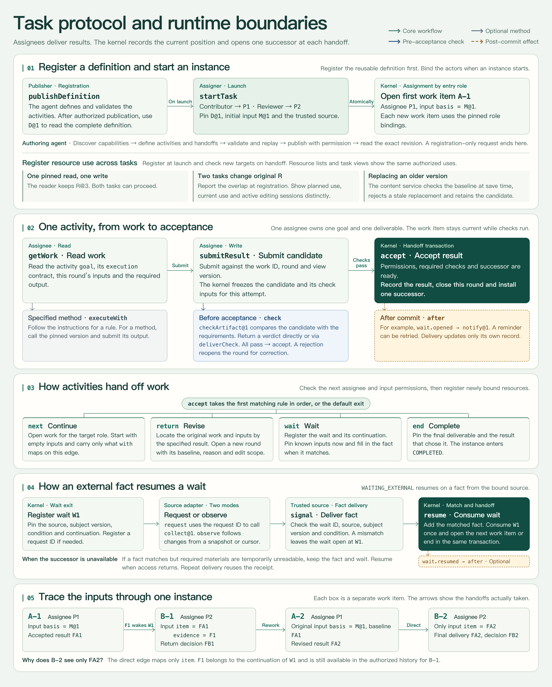

# 任务交互协议 1.0

[English](README.md) · 简体中文

这是一份纯服务端协议，约定任务服务与调用方如何登记任务、领取待办、提交成果和取得回执。一份任务定义描述谁负责、要交什么、按什么条件交接。任务服务解释定义，保存正式提交、验收和交接。人和 Agent 使用同一套授权接口。模型、编程语言、数据库和传输方式由接入方选择。

**前端展示属于应用扩展。** `readDefinition` 返回已登记的要求，`getWork` 返回获准查看的实例状态、待办和允许动作，`submitResult` 接收本轮成果。各应用按自己的风格决定如何呈现这些能力。仅通过服务端接口就能验证任务的登记、运行和完成，依据分别是可读回的定义修订、实例状态与操作回执、最终成果及其结束依据。

本版附可执行的本地登记和符合性演练。外部系统可以用相同文件和向量验证自己的接入。

**从一个例子开始。** “根据说明写一段结论。需要外部确认时等回执。复核者可以退回修改，最终交付采用的结论。”这句话对应两项活动、一个条件等待和一个结束出口。样例文件可以直接交给登记工具。[完整任务 JSON](review.task.json) · [定义格式](definition.schema.json) · [消息格式](messages.schema.json)

[运行本地示例](#local-walkthrough) · [接入自己的系统](#integration) · [详细设计与验收用例](docs/任务系统协议与运行边界_详细设计.md)

<details>
<summary>查看协议总图</summary>



可在下载的仓库中打开[交互图](docs/assets/task-system-core-protocol.html)，使用图上的语言入口切换中文，也可查看[高清静态图](docs/assets/task-system-core-protocol.png)。

</details>

<a id="integration"></a>

## 接入自己的系统

把接入 Skill 和本仓库交给开发 Agent。它会沿用你系统中的任务或分配，接通定义登记、领取待办、提交与结果读回。例如可以说：“用 `$task-protocol-integration` 把协议接入现有复核队列。验证服务重启后，复核者能读到最终采用的版本。” [英文 Skill](skills/task-protocol-integration/SKILL.md) · [中文译文](skills/task-protocol-integration/SKILL.zh-CN.md)

使用 Codex 时，在**要接入协议的应用根目录**运行下列命令。命令会把协议仓库克隆到应用的同级目录，再通过符号链接让 Skill 找到配套的规范、样例和回放工具。已有本地副本时，把 `protocol_dir` 设为其绝对路径，从 `mkdir` 那行开始执行。也可以直接让 Agent 读取 `SKILL.md`。

```sh
protocol_dir="$(dirname "$(pwd -P)")/task-interaction-protocol"
git clone https://github.com/alcheme-labs/task-interaction-protocol.git "$protocol_dir"
mkdir -p .agents/skills
ln -s "$protocol_dir/skills/task-protocol-integration" .agents/skills/
```

按接入场景可选用两个配套协议。

- **开发独立服务时**，ServiceSeed（原名 ServerAgent）提供在明确的服务契约和权限下创建、连接与维护服务的约定。[ServiceSeed 的 GitHub 仓库](https://github.com/alcheme-labs/ServiceSeed)
- **应用要接入用户自有 Agent 时**，Agent Bridge Spec（`local-agent-bridge`）提供应用与本地或远程 Agent 的连接和授权约定。任务操作仍由任务服务核验权限并出具回执。[Agent Bridge Spec 的 GitHub 仓库](https://github.com/alcheme-labs/agent-bridge-spec)

## 1. Agent 从一句话到一份已登记的任务

| Agent 需要回答的问题 | 写下或调用什么 | 完成依据 |
| --- | --- | --- |
| 最后交什么，谁能判定通过 | 写总目标和最终交付。把原话中的必交项、检查、外部条件及返修范围逐条对应到字段或规则 | 能指出最终交付取自哪份正式成果，以及谁作出结束决定 |
| 为了得到它，责任要交接几次 | 每次独立交付写一个活动。填写责任角色、子目标、输入来源、做法、输出和接纳条件，给每个出口写清下一步 | 能沿每条路径走到结束。被退回时能指出要改哪一版、哪几个字段 |
| 这个执行端做得到吗 | 调用 `describeTaskProtocol` 发现当前获权能力。规则型活动直接给说明，指定方法、资料用途或外部来源时逐项核对 | 每项依赖都有合法绑定方式。要派给具体的人时，能区分同名对象 |
| 定义符合原意吗 | 调用 `validateDefinition`。为正常和例外路径各给出具体提交、外部事件及预期结果，在隔离环境推演 | 能解释“为什么退回”“再次提交会不会重复开待办”。结构及映射错误由 Agent 按字段路径修正 |
| 用户要登记，还是现在派发 | 获登记授权后调用 `publishDefinition`，用返回的修订调用 `readDefinition`。用户同时要求开始且获启动权，再调用 `startTask` | 登记成功有可读回原文的修订。启动成功另有实例号，第一位执行者能读到自己的目标、输入和要交的成果 |


**怎样区分活动、检查、等待和提醒**

| 原话中的动作 | 如何表达 | 原因 |
| --- | --- | --- |
| “复核者决定是否采用结论” | 独立的 `review` 活动，输出采纳或附理由退回 | 换了一位责任人，并且要正式交出可追溯的决定 |
| “交结论时填写是否要外部确认” | 当前活动的必填 `bool` 输出，交接读取 `out.confirm` | 由当前执行者随成果一次提交 |
| “接纳前必须确认文件合格” | `checks` 引用已登记的检查方法 | 检查方给本次候选判定，通过后内核才接纳 |
| “确有回执才继续”“顺便提醒一下” | 前者用 `wait` 绑定事实来源，后者用 `after` 订阅已提交事件 | 等待的事实有来源、对象和条件。提醒送达与否不改变进度 |

角色槽名、字段名、顺序连接、规则型活动默认沿用子目标，均可由 Agent 生成。“须由另一位接班人确认”是一项身份约束，应写成 `"distinctRoles":[["writer","reviewer"]]`。仅写两个角色名仍允许绑定同一主体。若“通过”的含义会改变最终交付、两个人都可能是指定复核者，或改原稿与交副本产生不同后果，先查用户原话和获权目录。仍有歧义才问一个业务问题。工具应提供可选名称，Agent 自行解析内部 ID。缺少必要能力时保留已完成的设计，指出受影响的路径。

**可直接交给编排 Agent 的工作指令**

> 从用户要的最终交付反推活动。每当有人要独立提交一个成果或决定，才开新活动。每项必交内容应有输出和接纳规则，每个条件应能指出事实来源。例如，要求交一份文件时，在活动输出中声明必交的版本化文件引用，上传控件由接入应用选择。按获权目录选择方法和来源。验证各条路径后，依用户指令登记或启动。分别用精确修订、实例和首个待办证明完成。缺权、歧义或能力不足时，指出具体字段及其对结果的影响。

## 2. 可移植文件与执行规则

定义采用 UTF-8 JSON，每个对象的键必须唯一，数组保留先后顺序。YAML 可作等价展示，按同一棵 JSON 数据树校验。`protocolVersion:"1.0"` 指定协议格式，`taskId` 是逻辑任务名，根级 `goal` 是最终交付目标。`review-note@1` 是登记端分配的不可变修订，`instanceId` 标识一次启动。导入相同文件的另一端可自行分配修订标识。

| 定义部件 | 约束 |
| --- | --- |
| `roles`、`sources`、`start` | 定义责任角色及受信来源的槽位。启动时按现行授权绑定真实主体与初始输入，随实例固定。身份凭据由宿主管理 |
| `distinctRoles`（可选） | 每对列出必须由不同主体负责的两个已声明角色。预检与启动先解析真实主体，再核验每一对。别名指向同一主体仍是同一人。绑定冲突返回 `INVALID_BINDINGS`，首份待办尚未创建。缺省时允许同一主体承担多个角色 |
| `activities` | 每项活动只有一个责任角色和一个子目标。`execution.kind=rule` 由执行者选做法，省略说明时取该活动目标。`method` 必须解析指定方法版本。需证明实际用过时再声明凭据检查 |
| `input`、`output`、`with` | 端口类型为 `text`、`bool`、`ref`、`resultId`、`factId`。输入名末尾的 `?` 表示可省略。输出变体按 `kind` 选择字段。每次交接从空输入开始映射，可选来源缺省时仅可省略可选目标。字符串常量用 `{"const":"in.note"}` 表示。映射按使用阶段取得已知值 |
| `routes` | 同类型 `eq` 比较，按声明顺序取第一条命中，最后是唯一默认出口。`next` 开下一轮，`return` 固定原成果、修改范围与理由，`wait` 存续接点，`end` 指向本实例的正式成果。每个可达活动须有能到达结束的路径 |
| `checks`、`waits`、`after` | 必需检查绑定候选尝试。等待保存来源、对象、请求关联或起始游标、条件和续接映射。由来源推送事实。通知等事后订阅通过已提交事件的稳定标识去重 |
| 资料 | `ref` 指向可重读的固定版本，`resultId` 指向已接纳交付，`factId` 指向本等待受理的事实。正文根据本次用途、执行者和版本读取。共享文档时，各端须识别同一原件和同一登记范围。整份替换在原件服务比较写入基线，冲突时保留候选 |

**发布端核对语义。** 校验入口和角色是否存在、每条边映射的类型、沿该路径实际可用的数据，以及最终交付和返修基线的活动归属。`out.reason` 只在含 `reason` 的输出变体中可用，`factId` 只在相应等待恢复时可用。方法版本、用途、来源及必需能力须能由目录解析。宿主声明自己支持的版本和能力，遇到无法解释的版本、字段或必需能力，返回明确的诊断。

**跨宿主绑定。** 两端使用外部方法时，要绑定同一提供方命名空间和版本约定，并核对用途、输入输出以及结果所代表的事实。同名方法须有这些依据才能互换。外部凭据在本端管理。无兼容版本时由发现接口返回支持范围，缺必需能力时拒绝登记并指出路径。新协议修订须重新声明兼容，已运行实例持续使用启动时固定的约定。

**定义登记与资料登记。** 保存任务定义时记录读写用途。启动实例时，内核在建立首轮待办的同一事务登记已知资料，立即返回有权看到的重叠提示。分支绑定了新目标就再次查重。定义阶段的预检只说明当时可见的情况。

**交接保证。** 一个实例一次开放一个活动或一个等待。执行者用 `getWork` 读本轮 `work` 和获权的 `materials`，再用 `submitResult` 提交。待校验的候选冻结在本轮。拒绝后同轮补正，退回则打开新轮，按指定成果继承范围外的字段。`accept` 接纳一份成果并安装唯一后继，`resume` 消费匹配事实并安装唯一后继。相应回执与交接原子提交。完成时可读最终成果和结束依据，重启时从最后提交的位置继续。

**并行协作。** 若每人需要自己的待办，可各启一个子实例，父实例用请求型等待接收汇总。要求“三份都齐”时，受托方按父等待与请求号固定三个槽、子实例和交付版本。同一槽重放只记一次。三份齐全后，绑定来源交回一份汇总事实，父实例只恢复一次。剩一份未交时仍等待。若要求超时处置或任一完成，须明确声明条件且受托方支持。缺少可验证的汇总来源时，预检指出这条路径无法执行。单实例内同时开放多条独立推进的活动，需要另行协商并行扩展。

## 3. Agent 工具与交接消息

请求包含 `protocolVersion`、`op`、`params`。应答沿用版本和操作名，返回 `result` 或 `error`。身份、安全域和授权动作取自认证上下文。启动可以指定获授权的待绑定主体。传输层可选进程调用、HTTP 或 Agent 工具。[消息 JSON Schema](messages.schema.json)

| 操作 | 何时调用 | 成功或可处理的结果 |
| --- | --- | --- |
| `describeTaskProtocol` | 编排前按需发现版本、操作、能力和获权目录 | 当前能发现的执行者、方法、来源和资源。目录命中后还要核查此次操作权限 |
| `validateDefinition` | 校验草案，可附启动预案。只读，无派发和外部调用 | `valid`、`requires` 和带 `code/path/message/fix` 的 `issues`。带启动预案时另给 `launchable`。定义可登记时，具体人员或输入仍可待绑定 |
| `publishDefinition`、`readDefinition` | 在获授权目标登记，再按回执引用读回 | 首版传 `baseDefinition:null`，再版传预期旧修订。读精确修订取得当时的完整定义，读取时重验权限。登记成功时可尚无运行实例 |
| `startTask`、`getWork` | 获启动授权后，用分配、定义、角色绑定及输入启动 | 启动回执给出实例号。受指派的主体用它读取当前目标、获权资料、输出要求及允许动作。只要求登记时到上一行即完成 |
| `submitResult`、`signal` | 执行者交候选，受信来源为指定等待交事实 | 提交返回 `pending/accepted/rejected/invalidated`。信号返回 `pending/resumed/not_matched/already_resumed`。来源只取得自己的处理回执 |
| `getResourceUsage` | 查看获权原件的跨任务读写登记 | 取得可见的用途及冲突。其他任务的私有活动和正文按权限过滤 |

**如何比较执行端能力。** 1.0 的能力名区分大小写。按定义实际用到的内容推导 `requires`，编排者无需手工再维护一份能力清单。`roles.distinct` 对应非空的身份分离声明，`activity.method` 对应指定方法，按检查模式选择 `check.sync` 或 `check.async`，使用证明再要求 `check.methodReceipt`。等待按 `wait.<mode>.<semantics>` 标识，如 `wait.observe.state`，事后订阅使用 `after.event`。版本化资源自动要求 `resource.readVersion`，显式原件用途加 `resource.readLive`、`resource.edit` 或 `resource.replace`。跨端登记须能解析到共享的实际资源与登记服务。具体方法版本、来源和资料是否获权仍按用途另外核验。

**启动参数从哪里来。** 注册新定义时，宿主检查调用者是否可以在该命名空间创建或修订指定 `taskId`。`assignmentId` 由原指派方提供。它可以是已存在的获权分配，也可以是宿主根据本次明确派发指令签发的稳定分配标识。它随受托调用上下文提供，或从授权目录的 `assignment` 项取得。同一次派发重试始终解析到同一项。`startTask` 方可将分配与实际实例关联。缺启动授权时仍可完成已获准的定义登记。

**两个真实含义不同的消息。** 第一条是登记回执。第二条才为这次分配绑定执行者、开启实例。来源从宿主的可信配置解析。消息 Schema 分别校验数组中的每个封套。

```json
[
  {"protocolVersion":"1.0","op":"publishDefinition","result":{"definition":"review-note@1"}},
  {"protocolVersion":"1.0","op":"startTask","params":{"assignmentId":"assignment-7","definition":"review-note@1","bindings":{"writer":{"kind":"member","id":"P1"},"reviewer":{"kind":"agent","id":"P2"}},"input":{"brief":"说明两轮结果是否一致，并给出依据。","caseKey":"C-7"},"requestId":"start-7"}}
]
```

**修复一处，再重验原任务。** 例如 Agent 在示例的普通顺接边误写 `"evidence":"factId"`。预检可指向 `/activities/draft/routes/1/default/with/evidence`，说明“直接复核路径上尚无外部事实”。修复方法是从这条边去掉可选证据，保留等待恢复边上的映射。如果业务要求每次必有证据，则应改相应路径经过等待。字段路径使用 JSON Pointer。缺发布权时，沿宿主获权的草稿入口保存，并明确告知仍待登记。预检时成立的条件，在登记和启动时分别重验。

**登记与重试。** 登记在同一个逻辑任务上比较 `baseDefinition`，版本写入与回执原子提交。新请求基线过期返回 `STALE_BASE`，先读取当前修订并核对差异。原请求同键同内容回原回执，换内容返回 `KEY_CONFLICT`。比较内容时对象键顺序无意义，数组顺序有意义，摘要覆盖目标及完整参数。重放时先核查当前回执可见范围。内联发布保留服务端现存草稿及其编辑依据，旧实例一直绑定自己的定义修订。连接断开时使用原键和原参数查回或重投。

启动独立按分配、定义、角色和输入判重，同一分配和修订换绑定返回 `START_CONFLICT`。若登记成功但启动失败，保留已发布修订和失败原因。确认启动没有生效、且确需更改参数时才产生新的启动请求。新提交核对权限、`workId/round`、在途尝试与 `expectedViewSeq`。信号核对来源、等待、对象以及来源版本或请求标识。同一位置上的两个并发命令最多交接一次。外部通知的送达记录只表明通知状态。

**等待的接续。** `observe/state` 先取得一致快照及对应游标，再接收带来源版本的变化。新状态可以使未决旧状态失效。`observe/event` 以登记时的可信起始游标为边界。`request` 先持久化关联请求，再用原号投递。匹配结果可以先于送达确认。已持久接管的一方负责故障后接续。已发出的外部写入仍可能生效时保留请求和资料登记，直到来源确认终态。

## 4. 用同一份定义验收

样例中的撰写者和复核者分别绑定为 P1、P2，观察来源绑定为 S1。向量的 `start.sources`、提交中的 `actor` 和信号中的 `source` 是隔离夹具注入的受信上下文。实际协议从认证及绑定取得这些身份。为表示迟到事件，向量用活动或等待名加轮次定位旧对象，实际消息使用 `workId` 或 `waitId`。给两个独立执行端同样的任务、提交和外部事实，它们应得到相同的业务回执、待办或等待位置和最终交付。各端分配的内部 ID 依其指向的活动、轮次与成果归属对应。[输入及期望结果](conformance.json)

| 路径 | 可观察结果 |
| --- | --- |
| 直接复核 | 漏交必填项留在原轮，补齐交给复核者。原键重放返回原回执，采纳后读回撰写者的结论 |
| 等待、退回、再交 | 错来源、错对象、过期或不满足的事实均保留等待。匹配只恢复一次。退回后上轮提交过期，本轮只改开放字段，其余内容沿用原成果 |
| 再进同名等待 | 第二次等待开放后，发给旧等待的迟到事件得到旧等待已消费的回执。新等待接收自己的事实，最终交付采用本轮修订的结论 |

**首次编排实测。** 一位首次使用此协议的 Agent 只收到“记录人交摘要，另一位接班人可写理由退回或确认，先登记、暂不派发”。第一版的两个角色槽仍可由同一身份兼任。增加身份分离约束后，Agent 根据本页自行修订，在隔离登记库取得 `duty-handover@2`，按回执读回了完整定义，第一版仍可读，业务实例数为零。两种解释端都在同一身份尝试兼任时于首个待办前拒绝启动。两位不同主体则走完退回、修订、确认，最后取回第二版摘要。文件可用作两人交接的起点。[Agent 实际登记的任务](handover.task.json) · [英文交接示例](examples/en/handover.task.json)

<a id="local-walkthrough"></a>

### 运行本地示例

在本目录执行下列命令。登记端使用 Python 3、`jsonschema` 4.18 至 4.x 和 Python 自带的 SQLite。数据写入当前用户持有的临时目录。命令 `describe`、`validate`、`publish`、`read` 依次对应能力发现、定义校验、登记与精确读回。命令行通过退出码及 `ok` 字段返回结果，接入为 Agent 工具时按第 3 节封装消息。

```sh
samples=.
scratch="$(mktemp -d)"
python3 -m venv "$scratch/env"
py="$scratch/env/bin/python"
"$py" -m pip install 'jsonschema>=4.18,<5'
"$py" author.py describe
"$py" author.py validate "$samples/review.task.json"
"$py" author.py publish "$samples/review.task.json" --db "$scratch/registry.sqlite" --request-id setup-1 > "$scratch/published.json"
revision=$("$py" -c 'import json,sys; print(json.load(sys.stdin)["definition"])' < "$scratch/published.json")
"$py" author.py read "$revision" --db "$scratch/registry.sqlite" > "$scratch/read.json"
"$py" -c 'import json,sys; print(json.dumps(json.load(sys.stdin)["document"], ensure_ascii=False))' < "$scratch/read.json" > "$scratch/registered.json"
"$py" replay.py "$scratch/registered.json" "$samples/conformance.json" --first-work
"$py" replay.py "$scratch/registered.json" "$samples/conformance.json"
node replay.mjs "$scratch/registered.json" "$samples/conformance.json"
```

登记工具持久保存定义。`--first-work` 按第一位夹具执行者的身份展示真实映射出的子目标、输入及输出结构。Python 和 Node 两个独立的离线解释端均从读回的正文计算轨迹，可直接对照两条命令的 JSON 输出。本地夹具提供参与者身份、初始输入和外部事件。每条轨迹输出启动位置、逐事件业务回执与最终交付。接入真实宿主还需在获授权的入口验证登记与启动、撤权、重启、外部已经提交但确认丢失，以及并发消费同一等待。 [宿主验收用例 T01–T41](docs/任务系统协议与运行边界_详细设计.md#tests)

协议行为有变动时，在同一次修改中同步更新中英两版、对应的验收编号和接入 Skill。两版共用 Schema 和回放工具。英文与中文样例使用各自的任务文案和临时登记库，保持用例名称、事件顺序和预期回执一致。图有变动时，在交互 HTML 中同步更新两种语言的标注，并用英文 `?view=poster` 视图导出整页 PNG。

## 许可证

本仓库采用 [Apache License 2.0](LICENSE)。
