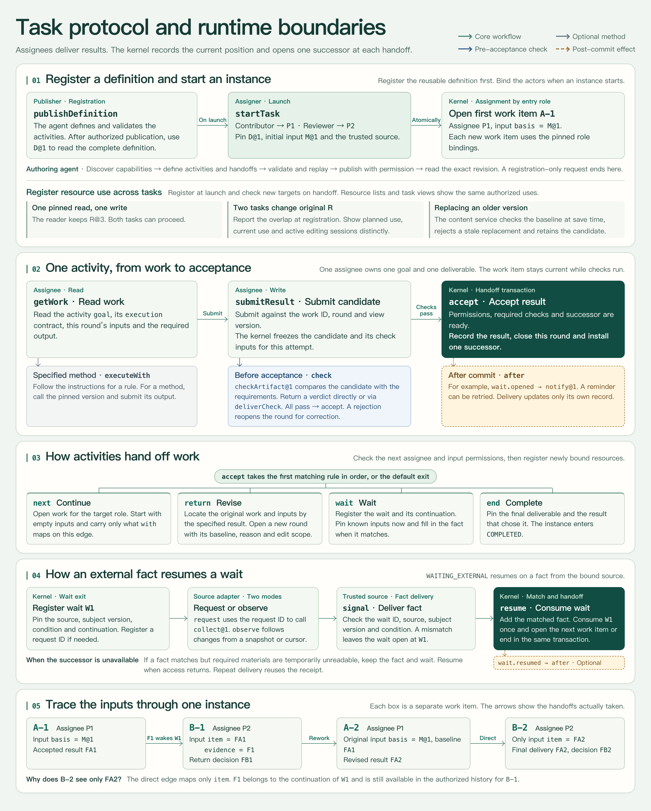

# Task protocol and runtime boundaries

English · [简体中文](任务系统协议与运行边界_详细设计.md)

**Detailed design · 2026-11-20 · For product teams, service implementers, integrators and testers**

One assignee owns one deliverable for each activity. When the task service accepts that deliverable, it also decides what happens next. Handoff rules connect activities into a task instance. Reading the instance reveals its current work item, the external fact it is waiting for, or the final deliverable and the decision that selected it.

[Portable protocol and agent authoring](../README.md) · [Launch and roles](#activation) · [Activity definitions](#definition) · [Context](#context) · [Cross-task resource use](#resource-usage) · [Transitions](#transitions) · [Interfaces](#interfaces) · [External waits](#external) · [Storage and adoption](#storage) · [Trace and acceptance](#trace)

<a id="architecture"></a>

## 1. Components and write authority



Read from the top. `startTask` pins the roles and registers known resource uses. `accept` records a result and selects an exit. `resume` consumes a wait on a matching fact. The last row shows how inputs change when the same activity opens a second time. Green marks the core path, gray an optional execution method, blue a pre-acceptance check, and dashed gold a post-commit effect. Open the HTML from the checkout to try the simulation. [Interactive diagram](assets/task-system-core-protocol.html) · [Full-resolution image](assets/task-system-core-protocol.png)

| Participant | Facts it may write | What the next participant receives |
| --- | --- | --- |
| Definition publisher | Published activities, handoff rules and method versions | An instance binds to an immutable definition revision at launch. |
| Assignee (person or agent) | Its own candidate content or the decision it is responsible for | A submission to the task kernel through `submitResult`. |
| Task kernel | Work items, accepted results, handoffs, waits and receipts | An authorized instance view from `getWork`. Only the kernel writes the instance position. |
| Checker or external source | The checker owns its verdict for this check. The source owns its external facts. | Verdicts go to the assigned attempt. Facts go to the assigned wait through `signal`. |
| Resource or document service | Resource identity, read/write authorization, actual editing sessions and saved versions | The kernel registers task uses. The original content service merges collaborative updates or saves a replacement after checking its baseline. |
| Post-commit subscriber | Its own delivery or processing records | Consumes events after the core transaction commits. |

**Protocol boundary.** The service protocol specifies operations, data, permissions, transitions and receipts. Each application designs its own cards, lists and detail views. Reading or refreshing an open work item leaves it assigned to the same principal. Whether the assignee submits through a page or a bot, the service checks permission, work item and round, then advances according to the definition on acceptance.

<a id="definition"></a>

## 2. Activity definitions and composition

Every activity has its own `goal`. An external author breaks down the overall task, specifying what each step must deliver, how to perform it, its inputs, its output shape and its acceptance conditions. `assignee` names the role bound to a real actor at launch. The kernel opens work from the activity in the pinned revision.

<a id="activity-execution"></a>

**Goal and execution contract.** A required `activity.goal: text` answers “What must this step achieve?” Each new activity declares one of the following `activity.execution` forms. People and agents receive the same contract.

| Published form | What the assignee reads from `getWork` | When to use it |
| --- | --- | --- |
| `{kind:"rule", instructions?:text}` | `work.execution.instructions` returns the published instructions. When omitted, it returns this activity's verbatim `goal`. | The assignee chooses its tools. “Keep only the latest record for each ID” can serve as both goal and rule. |
| `{kind:"method", executeWith:{method,with?}, instructions?:text}` | `work.execution.executeWith` supplies the specified method version and this round's bound arguments, with any additional instructions. | A registered implementation is required. The provider owns the method. The assignee submits the result. |

An author may fill in `{kind:"rule"}` when drafting an activity described only by its goal. Publication requires a nonempty goal and exactly one execution form. For a method, resolve the version and purpose. Its `with` mapping can use only definition constants and this round's `in` values available before the call. Omitting it gives an empty argument set. Conflicting forms, missing required bindings, references to future outputs and unregistered methods yield `INVALID_DEFINITION`. Put requirements that must block acceptance in `output` or `checks`. Configure proof of use when verification of the actual call is required. [Method-use receipts](#method-use)

For the latest-record goal, use `execution: {kind: rule}`. If the task requires catalog method `clean@2`, use `execution: {kind: method, executeWith: {method: clean@2, with: {records: in.records}}}`, where `records` is a declared input port on the activity.

**Storage and retrieval.** `publishDefinition` stores each activity's `goal` and `execution` in the same definition revision. `startTask` pins that revision. The kernel looks up the instance's definition revision and the current work item's `activityId`, then combines that contract with the round's frozen inputs to produce `work.goal` and `work.execution`. Refresh, asynchronous checks and new rework rounds use the same revision. Changing a goal or execution contract requires a new revision.

`activityId` identifies an activity in the definition, `workId` one visit to that activity, and `attemptId` one formal submission attempt in that round. The kernel assigns a `resultId` on acceptance.

Here is a portable definition for task D. The first revision in this example is D@1. `1.0` is the protocol format version. The two role identifiers, `交付者` (contributor) and `复核者` (reviewer), and source slot S belong to the definition. The host supplies actual principals, permissions and revision identifiers. [Definition schema](../definition.schema.json)

```yaml
protocolVersion: "1.0"
taskId: D
goal: Deliver the accepted result chosen by the reviewer and retain the closing decision
roles: [交付者, 复核者]
sources: [S]
start: {input: {basis: ref}, activity: A, with: {basis: start.basis}}
activities:
  A:
    assignee: 交付者
    goal: Deliver a versioned artifact
    execution: {kind: rule}
    input: {basis: ref}
    output: {artifact: ref, needsExternal: bool}
    checks:
      - {id: C, method: checkArtifact@1, criterion: The artifact version must meet this round's requirements, mode: async, with: {basis: in.basis, artifact: out.artifact}}
    routes:
      - when: [out.needsExternal, eq, true]
        exit: {wait: externalReady}
      - default: {next: B, with: {item: result}}
  B:
    assignee: 复核者
    goal: Choose the result to adopt or specify what needs revision
    execution: {kind: rule, instructions: Review this result. Give a reason if you return it.}
    input: {item: resultId, "evidence?": factId}
    output: {variants: {return: {reason: text}, finish: {}}}
    routes:
      - when: [out.kind, eq, return]
        exit: {return: A, base: in.item, edit: [artifact, needsExternal], reason: out.reason}
      - default: {end: in.item}
waits:
  externalReady:
    mode: request
    method: collect@1
    source: S
    subject: out.artifact
    semantics: event
    fact: {ready: bool}
    when: [fact.ready, eq, true]
    resume: {next: B, with: {item: result, evidence: factId}}
after: {wait.opened: [notify@1]}
```

**Reading a definition.** A `ref` has the shape `{id, version}` and identifies a fixed object version. `text` is nonempty text and `?` marks an optional input. A `when` condition compares same-type values as `[field, eq, constant]`. Any computed value used for routing must appear in a declared deliverable field and pass acceptance checks. Output `kind` selects a `variants` entry, for example `{"kind":"return","reason":"Revise the indicated fields"}`. Mappings read only launch input `start`, current input `in`, current output `out`, this round's accepted result ID `result`, and verified external `fact/factId` as available.

**Publication rules.** Entry and exit targets must exist. The mapping on every reachable path must supply inputs of the required types. Evaluate branches in declaration order, take the first match and require one default at the end. A return must locate, from its input, a specific result accepted by the target activity in this instance. Its edit scope must belong to that activity's output. Resolve check, wait and post-commit methods by version and purpose. Refuse publication if any check fails. A new revision affects only instances bound to that revision.

<a id="activation"></a>

### 2.1 Publication, launch and role binding

| Management operation | Caller and preconditions | Successful result |
| --- | --- | --- |
| `validateDefinition({document,launch?})` | A principal can check a definition against its authorized catalog and may include proposed launch parameters. | Read-only diagnostics provide field paths, reasons, remedies and required capabilities. Report definition validity and launchability with these bindings separately. |
| `publishDefinition({document,baseDefinition,requestId})` | A principal authorized to register against the target task. Inline publication identifies the target by `document.taskId` and expects a null baseline for the first revision. The host's existing `{taskId,draftRevision,requestId}` draft entry point may use the same publisher. | Commit the document, immutable revision and idempotent receipt together. An outdated registration baseline yields `STALE_BASE`. A changed draft yields `STALE_DRAFT`. Inline registration preserves other people's unpublished drafts and their original baselines. In-flight instances retain their revisions. |
| `readDefinition({definition})` | A principal with current permission to read this exact revision. | Read the complete machine-readable document by the published reference, including before launch or after a newer revision exists. Recheck permission at read time. |
| `startTask({assignmentId,definition,bindings,input,requestId})` | An authorized caller or delegated service can launch this assignment. The published definition matches it, each role resolves to an assignable `{kind,id}`, and entry inputs meet type and use permissions. | In one transaction store the launch basis, create the instance and first work item, register known resource uses and check overlap. Return `{instanceId,definition,startedAtSeq:1,resourceUsage?}` with any visible overlap in this response. Read current progress with `getWork`. |

Registration yields a reusable definition. Follow it with launch only if authorized dispatch is also requested. Obtain `assignmentId` from the assigner's trusted context or an authorized catalog. The same dispatch instruction resolves to the same assignment. Creation of the running assignment remains atomic with launch. Both inline and draft publication check target permissions, comparing the definition baseline and draft revision respectively. Reconcile a draft based on an older definition first. Handle changed launch bindings or failed launch through the launch operation and retain the registered revision. [Authoring and registration workflow](../README.md)

For D@1 an example binding is `{交付者:{kind:"member",id:"P1"}, 复核者:{kind:"agent",id:"P2"}}`. One principal can hold both roles by default. Declare `distinctRoles` if the request specifies “another person” or requires separation of duties. Compare canonical principals after authorized catalog resolution. Conflicting, missing, duplicate or unknown role bindings yield `INVALID_BINDINGS`. A wrong initial material type yields `INVALID_INPUT`. If trusted configuration required for a first launch is temporarily unavailable, return `UNAVAILABLE`. These failures create neither instance nor work. Resolve S's identity and purpose from trusted configuration and pin them with the role bindings. Reuse the bindings and recheck the actual principal's current permissions whenever opening work.

The launch key is `(security domain, caller principal, requestId)`. The business uniqueness key is `(assignmentId,definition)`. Check assignment access from authenticated context, and check visibility of any existing instance. Compare original key and digest first. Changed content under the same key yields `KEY_CONFLICT`. A successful replay returns its stored receipt and uses the original source identity. If a fresh key finds an existing instance, compare normalized caller-supplied role bindings and initial inputs. If equal, store the new key, digest and success receipt for the original instance in one transaction. Otherwise return `START_CONFLICT`. Replays of that new key also check its content. Existing publication or assignment flows can invoke launch. Rebinding during execution is an optional extension. The core bindings last until the instance ends.

<a id="context"></a>

### 2.2 Who stores context and when it is copied

| Scope and owner | What is pinned and when | Retrieval across handoff or restart |
| --- | --- | --- |
| Instance, task kernel | At launch, definition revision, initial input values or versioned references, bound actors and sources. | Read the launch basis by `instanceId`. Both successors and returns obtain their assignee here. |
| Work item, task kernel | On opening, `workId/round`, assignee, inputs mapped on this edge, incoming transition, rework baseline and scope. Read the goal, execution and acceptance rules from the bound activity revision. | The next assignee reads the round with `getWork`. Apply `with` to empty inputs each time. Unmapped optional fields are absent. |
| Attempt, task kernel | On submission, the complete normalized candidate, originating work item, check method versions and inputs. | Retries and late callbacks address the original `attemptId`. A new candidate gets a separate attempt. |
| Wait, task kernel | On opening, source, subject and its version, condition, correlated request or starting point, and known continuation values. | Add only the fact accepted for this wait to construct successor inputs. |
| Content, drafts and permissions, original services | The task stores referenced versions. A draft enters a candidate on formal submission. | Read content by exact version under current permissions. Earlier history, chat and local drafts enter new work only through explicit inputs. |

**Delivering to the next assignee.** Apply mappings against the target activity's input types. Mapping a `resultId/factId` hands over the fields declared in that output or fact structure and their versioned references. To hand over a single field, select it in `with`. Before opening work, verify access for the target principal and purpose, including nested materials actually used. If a mapped reference is unavailable, do not substitute a latest version or a same-named field from the last round. Reject an invalid upstream candidate reference by field path. If the candidate or external fact is valid but the successor's required material is temporarily unavailable, retain the attempt or wait and record the reason. Return `pending` after taking durable responsibility. Recover using the original version and current authorization. If the original service confirms permanent destruction of a required version, stop automatic retries. Settle the attempt as `invalidated` or the signal as `not_matched(invalidated)`, retaining the position, reason and basis for administrative action.

<a id="resource-usage"></a>

### 2.3 Cross-task resource-use registration

Each instance advances independently under its `instanceId`. Queries by instance or original resource return authorized resources, related tasks, read/write purposes and stages. Register known targets at launch and report overlaps immediately. Tasks can continue after an alert. The content service enforces write conditions when saving the original.

**Declaring use.** Register each bound, readable versioned resource as `readVersion`, including resources expanded from mapped `resultId/factId` values. Declare additional access on the activity as `resourceUses?: [{target,mode}]`. For example, `{"target":"in.basis","mode":"replace"}` declares replacement of the original identified by `basis`. `edit` requires a provider that supports collaborative updates. `replace` requires conditional saves against a baseline. Validate paths, modes and known capabilities at publication. At actual binding check the target, assignee's current permissions and provider capability.

If a target permanently lacks the declared write capability, a required entry target yields `INVALID_INPUT`. If a successor target came from an invalid candidate, reject the attempt by field. If a valid candidate or fact leads to a permanently infeasible successor, settle as `invalidated` or `not_matched(invalidated)` as in section 2.2. Retain the position and incompatibility reason. Recover automatically only when the dependency is temporary or unresolved.

| Two instances using the same target | Feedback at registration | Write constraint |
| --- | --- | --- |
| A pinned `readVersion` alongside any read or write, or independent copies from the same input | Both can proceed. List the bound versions without a conflict alert. | The pinned version must stay rereadable. Independent copies have distinct object IDs. |
| `readLive` alongside `readLive` | Both can proceed without a conflict alert. | If live content determines acceptance or routing, pin the version actually used in the candidate. |
| `readLive` alongside `edit` or `replace` | Indicate that the original being read may change. | An activity requiring stable input reads its bound version. |
| `edit` alongside `edit` | Immediately report that both tasks are editing or intend to edit the same original. Both can continue. | The content service merges authorized edit deltas. Assignees can resolve differences in business content. |
| `replace` alongside `edit` or `replace` | Immediately report overlapping writes and retain both candidates. | The original owner compares the current baseline and saves in one transaction. Reject a replacement based on a stale version. |

**Identifying an original.** The content service resolves paths, attachment references and document entry points to `resourceKey=(security domain, content service, original ID)`. Store version separately so write intents on different versions of the same original still meet. Compare uses pairwise. A pinned read cannot mask a write declared by the same task. Independent documents with the same name have distinct keys. Saving a copy creates a new object. If the user chooses to overwrite an existing location, the content service resolves the actual target and handles it as `replace`. Sources unable to retain versions may declare live reads. An activity needing a stable input must first obtain a rereadable snapshot.

| When | Registration behavior |
| --- | --- |
| `startTask` | Register every target already identifiable from launch inputs with the instance and first work item. Mark the current use `current` and known future uses `planned`. A conditional branch can indicate possible use and only anticipated overlap. If a target depends on a later result, keep the declaration and check when its real ID is known. |
| `accept / resume` opens a successor, or a return reopens work | Resolve the kernel's actual inputs in the work-opening transaction. Realize plans, register newly known resources and check overlap immediately. Close the previous round's uses and remove plans excluded by the route. Register rework with the new `workId` and current baseline. A simple wait releases the previous use. If a request wait delegates continued use, register its declared `resourceUses` against `waitId/externalRequestId`, binding frozen `in/out/result` references from this round. |
| Completion, cancellation and recovery | Remove plans and uses of closed work. Closing a page ends only its editing session. For an issued request that may still write, release its registration on the original request's terminal outcome as in section 5. Recover from committed instances and requests. Replaying the original key adds no registration or alert. |

`planned` means a use is anticipated. `current` means open work or an active delegated request has bound it. Display “editing” only while the original document service confirms an authorized editing session for that `workId` or delegated request. Aggregate windows by work item. After the last session ends or expires, display intent to edit again. A pinned read may say “using version 3.” Mark a delegated change with an unknown outcome as “write awaiting reconciliation.” The original service checks round permission and purpose at write time. Late operations after termination look up receipts by their original key. Saved versions remain traceable after cancellation.

**A replacement conflict.** Instance A prepares a replacement of R from version 3. Instance B also registers a replacement and its launch receipt reports the overlap. A saves version 4. When B submits its replacement based on version 3, the content service returns its version conflict (for example `VERSION_CONFLICT`). Keep B's draft or candidate readable. The assignee can read version 4, compare changes, confirm a merge and save with a new write request. If this activity permits revision only from version 3, obtain new work explicitly bound to the new baseline. An ordinary return uses the original inputs, and B's draft stays available. An activity that allows copies can deliver one separately. When an update to the original is required, check its save receipt at acceptance.

<a id="states"></a>
<a id="transitions"></a>

## 3. Runtime state and handoff transactions

An instance has one current position. Each conditional branch selects one successor. Different instances progress independently. Both open work and work pending acceptance belong to `ACTIVE`. The `attemptId` distinguishes submissions in one round.

```text
ACTIVE / OPEN(workId, round)                The current assignee may submit.
ACTIVE / PENDING(workId, round, attemptId)  The candidate is frozen. The kernel owns further processing.
WAITING_EXTERNAL(waitId)                    The preceding result was accepted. A specific external fact is due.
COMPLETED(finalResultId, decisionResultId)  Both the deliverable and the decision that selected it can be read.
```

A `pending` attempt settles as `accepted/rejected/invalidated`. Synchronous submission can yield a terminal outcome immediately. A wait goes from `open` to `consumed` or `cancelled`. A signal outcome of `pending` or `not_matched` leaves the wait in place.

| Current position | Input and guards | Required result in one transaction | After commit |
| --- | --- | --- | --- |
| Before launch | Launch a published definition with a valid assignment | Pin the revision and create the instance and first work item. | Open |
| Open | A candidate fails an output rule or synchronous check | Record the attempt, rejection reason and field paths. Create no accepted result. | Original work open |
| Open | Required checks are outstanding or an acceptance dependency is temporarily unavailable | Freeze the candidate, method versions and in-flight attempt. Persist recoverable work and return `pending`. | Original work pending |
| Pending | This attempt receives a rejection, or original submission authority has been confirmed revoked | Settle as `rejected` or `invalidated` respectively. Release the work item for correction and recompute allowed actions. | Original work open |
| Pending | Some checks pass or a check encounters a temporary fault | Save verdicts or retry information and continue the same attempt. | Original work pending |
| Open or pending | Lifecycle permits progress. The candidate matches current work and round and, if pending, the current `attemptId`. Authority, scope, all required checks and successor are valid. | **Accept.** Pin one accepted result, close this round, record the selected rule, install one exit and write the final receipt. | See exits below |
| External wait | A trusted fact arrives for this wait | If the condition fails, record the handling outcome. If it matches, **resume** under section 5, consuming the wait and installing its successor atomically. | Existing wait or its registered successor |
| Any position | Read work, replay a receipt or deliver a post-commit notification | Preserve the core position. Terminal state remains readable. Answer late events for consumed waits as in section 5. | Same position |

| Acceptance exit | Successor | Evidence carried forward |
| --- | --- | --- |
| `next` | New work for the target activity | Map inputs with `with` and resolve the activity's assignee. |
| `return` | New work in the specified activity with its round incremented | Check that `base` is an accepted result of the target activity in this instance. Locate the originating work and bring back its inputs, edit scope and reason. Inherit values outside scope from that result and verify them on acceptance. |
| `wait` | One open wait | Pin source, subject, condition and continuation. Bind `in/out/result` in the mapping to concrete versions now. Fill `fact/factId` upon delivery. If external execution is required, register the correlated request in this transaction. |
| `end` | Completed instance | Pin the selected deliverable result and this round's closing decision result. Both may point to the same result. |

After launch, two operations can hand an instance to its successor. A synchronous submission or the last required passing verdict triggers `accept(attemptId)`. A matching `signal` triggers `resume(waitId,factId)`. Consume the wait only if the instance still points to that `waitId` and the fact belongs to it and satisfies its frozen condition. Recovery retries only an original operation for which the system took durable responsibility and applies the same guards. Both operations write the following record in the transaction that installs the successor. New work always gets a new `workId`, even for the same actor. Corrections and check callbacks retain the current `workId`.

```text
Transition = {transitionId, instanceId, from, ruleRef, basisRefs, to, appliedSeq}
```

`from/to` identify positions before and after handoff. `ruleRef` points to the exit or continuation in this definition revision. `basisRefs` holds the results or facts actually used.

**Transaction invariants.** Each work item has at most one pending candidate and at most one accepted result. Assign a fresh `workId` on each entry and increment `round` within that activity and instance. Correction in the same round retains `workId/round`. Compute the route solely from the pinned definition and candidate fields and store it with acceptance. Before completion, an instance with a runnable lifecycle has exactly one addressable work item or open wait. After natural completion it has neither.

**View versions.** `viewSeq` starts at 1. Increment once per transaction that freezes a pending attempt, rejects or invalidates an attempt on the current work item, accepts a result, consumes a wait or changes this instance's executable state through an administrative command. Partial verdicts, unmatched facts, receipt delivery and notifications alone leave it unchanged. Submit against the last version read. Clients compare versions only within the same instance and authorization context. A permission change invalidates cached and in-flight reads. Apply only the newest read in the current authorization context, including when a response from an older context arrives late.

**Administrative lifecycle.** `position` is the last installed workflow position. Read `lifecycle` from the existing management record and combine it with current access to determine whether action is allowed. A temporary read-only state retains the position and work already taken over. New writes yield `LIFECYCLE_BLOCKED`. The source retains unacknowledged verdicts or events and retries with the original keys when unblocked. Formal cancellation invalidates covered pending attempts, cancels open waits, and settles their durably accepted pending facts as `not_matched(invalidated)` in the management transaction. Retain accepted results and receipts. Explicit reopening restores only assignments covered by the decision and creates a new work round or wait ID. Reconcile issued external requests by their original IDs. Re-execution requires a basis in this new management decision. A late callback has no authority to reopen an instance.

<a id="interfaces"></a>
<a id="hooks"></a>

## 4. Participant interfaces and hooks

Assignees obtain an instance ID from an authorized work list or notification. A person uses a session identity and an agent a purpose-bound execution credential. Both read work and submit under the same rules. Assignees use `getWork` and `submitResult`. Only the bound source may call `signal`. Administrators use the publication and launch operations in section 2.1. Only the kernel invokes `accept/resume`. A question mark denotes an optional field.

```text
getWork(instanceId, requestId?)
  → {instanceId, definition, viewSeq, lifecycle, position, allowedActions, work?, materials?, receipt?, resourceUsage?}

getResourceUsage(ref | resourceKey)
  → {resourceKey, uses, alerts}

submitResult({instanceId, workId, round, expectedViewSeq, requestId, output, methodReceiptRef?})
  → {requestId, attemptId, outcome}

signal({waitId, eventId, subject, fact, externalRequestId?, sourceVersion?, cursor?})
  → {waitId, eventId, outcome}
```

| Operation | Authorized view | Result and meaning |
| --- | --- | --- |
| `getWork` | `work` includes the assignee, goal, inputs, output shape, checks, execution, rework scope and last correction reason. With progress-only access, `position` contains only authorized state names. Omit work, attempt, wait and result IDs and `work`. [Work view](#work-view) | Read-only. `allowedActions` is `[submitResult]` for open work the caller may submit and empty otherwise. Passing the original `requestId` looks up this principal's latest receipt on this instance. An unknown key yields no receipt. |
| `getResourceUsage` | The resource list and detail view show authorized current and planned uses and conflict alerts. | Read-only. A list can batch the same projection for one page of authorized resources. The content service supplies locations and names. |
| `submitResult` | The operation receipt describes this submission. Read `getWork` for the current assignee and position. | `pending` means the kernel took responsibility. Terminal outcomes are `accepted(resultId,transitionId,appliedSeq)`, `rejected(reason,paths)` or `invalidated(reason)`. |
| `signal` | The source sees its authorized event receipt. Request correlation, source identity and subject must match this wait. | `pending`, `resumed(transitionId)`, `not_matched(reason)` or `already_resumed`. See processing order in section 5. |

**Reading resource usage.** Optional `resourceUsage` on `startTask` and `getWork` is an authorized list relevant to the instance. A resource list or detail view may call `getResourceUsage` with a permitted original key or versioned reference. Both resolve the original to look up current uses. Each entry has this form.

```text
{resourceKey, uses:[{mode, stage, version?, instanceId?, activityId?, workId?, waitId?, taskLabel?, actorLabel?, editing?, reconciling?}], alerts:[code]}
stage = planned | current
code  = plannedOverlap | liveChanges | sharedWrite
```

Combine displayed uses only if instance, plan or current-round scope, resource, mode and bound version all match. Keep separate entries for `R@3` and `R@4` in one round. Compute conflicts only across different instances. The read/write combinations in section 2.3 yield `plannedOverlap` when one is still planned. Describe this as possible or planned. A current live read alongside a write yields `liveChanges`, and two current writes yield `sharedWrite`. Parallel reads give `alerts:[]`. `version` is the pinned read version or write baseline. Set `editing:true` only for a valid edit session. `reconciling:true` means a delegated write awaits reconciliation of its original request.

Shared usage requires permission to see that resource's usage. Match cross-task records within the security domain. Identifying another task or assignee requires access to its details. If the caller can know overlap exists but cannot see the other party, provide one merged anonymous alert. Hide the other parties' IDs, counts, names, paths and content. Without usage visibility, omit registration from lists and return `NOT_VISIBLE` on a direct query. Content remains subject to independent authorization by its owner. Progress-only instance views omit `resourceUsage`. Replay the original launch receipt on a repeated launch key and refresh its attached usage projection under current permissions.

The launch response includes permitted uses and alerts immediately. Upon handoff the next assignee reads current alerts from `getWork`. Both are informational and require no extra confirmation. A source receives only its own processing outcome from `signal`.

After the registration transaction commits, subscribers can use the existing notification mechanism to know when to reread usage. At dispatch recheck the recipient's permission and send only if their visible projection changed. An unchanged anonymous alert or a hidden overlap must generate no observable refresh event. Deduplicate by registration operation or transition, resource key and recipient. Clients reread, clear resolved alerts and discard expired responses or responses from older permissions. Another task's change of use does not advance this instance's `position/viewSeq`.

<a id="work-view"></a>

### 4.1 Work and materials returned

`work` describes the current activity. `materials` expands the content readable for this use. A question mark marks an optional field. `position` supplies `workId/round`. The structures below are fixed. The published activity supplies the business ports.

| `work` field | Type and source |
| --- | --- |
| `activityId`, `assignee` | Activity identifier and `{role, actor:{kind,id}}`. The role comes from the definition and the principal from this round's binding. |
| `goal`, `execution` | Verbatim activity goal. A rule returns `{kind:"rule",instructions:text}`. A method returns `{kind:"method",executeWith:{method,inputs},instructions?}`. `method` is a fixed-version catalog reference and `inputs` are the authorized values mapped by `with` in this round. |
| `inputSchema`, `input` | Published port types and optionality in the format of section 2, and the actual visible key/value pairs bound on this edge. Use the declaration to distinguish values, `ref`, `resultId` and `factId`. |
| `output`, `checks` | The output structure with applicable `variants`. `checks` is `[{id,method,criterion?,provesUse?}]` or `[]`. A `criterion` describes a check requirement visible to the assignee. |
| `rework?`, `correction?` | On return, `{base,edit,reason}` identifies the original accepted result, editable field paths and reason. If the previous submission in this round needs correction, return `{reason,paths}`. Both may be present. |

| `materials` field | Lookup and visible content |
| --- | --- |
| `results` | `{[resultId]:field object}`. Read the accepted attempt's formal output, projected to the selected fields and current permissions. |
| `facts` | `{[factId]:field object}`. Locate the wait event by fact ID and return declared fields the reader may see. [Fact body storage](#fact-body) |
| `resources` | `[{ref:{id,version},read}]`. Match on the pair `id,version`. The usable read entry point is `{kind:"link",href}` or `{kind:"capability",name}`. The first is the content service's authenticated address for that principal. The second invokes an existing capability at that version in the delegated context. Both check purpose, access and required content form. |

Return `materials` when there are visible references, including all three containers. Use `{}` for empty maps and `[]` for empty lists. Omit `materials` if no materials can be read. Expand only explicitly mapped inputs, an authorized rework baseline or permitted terminal deliverables and decisions. Apply the same authorization and deduplication to nested references. Filter restricted fields together with identifiers, versions, method parameters and read entry points. When opening a successor, check the interface and purpose the intended reader can actually use. Remove `submitResult` if required input can no longer be read or processed. Evaluate every request against its current principal and purpose.

In `ACTIVE/OPEN` and `ACTIVE/PENDING` callers with work-detail access may read the same round's `work`. Pending work returns `allowedActions=[]`. `WAITING_EXTERNAL` exposes the authorized wait position. `COMPLETED` exposes the authorized end position and materials. Both omit `work`. Progress-only views omit `work`, `materials` and restricted identifiers. An assignee looking up its original `receipt` is subject to the same visibility limits.

**Example at B-1.** The excerpt shows P2's authorized `work` and `materials`. P2 can see two output fields of FA1 and has a delegated `resource-read` capability for the required text at that version. The adapter passes the original resource ID and exact version from `ref` to its owner. P2 can index `materials.facts` directly with `work.input.evidence`.

```json
{
  "work": {
    "activityId": "B", "assignee": {"role":"复核者","actor":{"kind":"agent","id":"P2"}},
    "goal": "Choose the result to adopt or specify what needs revision",
    "execution": {"kind":"rule","instructions":"Review this result. Give a reason if you return it."},
    "inputSchema": {"item":"resultId","evidence?":"factId"},
    "input": {"item":"FA1","evidence":"F1"},
    "output": {"variants":{"return":{"reason":"text"},"finish":{}}}, "checks": []
  },
  "materials": {
    "results":{"FA1":{"artifact":{"id":"asset","version":1},"needsExternal":true}},
    "facts":{"F1":{"ready":true}},
    "resources":[{"ref":{"id":"asset","version":1},"read":{"kind":"capability","name":"resource-read"}}]
  }
}
```

The direct edge into B-2 maps only `item=FA2`. Even for the same reader P2, `work.input` omits `evidence` and `materials.facts` is empty. Read historical data by the specific work or transition ID through the existing authorized history interface.

**Submitting after a return.** Ordinary activities validate the complete `output`. For rework, first check permission to inherit or compare baseline fields for this purpose. Start from the accepted output identified by `base`. Overlay only submitted editable fields, then apply the original rules to the complete candidate. Inherit omitted fields. A supplied out-of-scope value must equal its original value. An explicit clearing value must satisfy the output type.

`position.state` distinguishes the three global states. Active work has `position.phase` of `OPEN` or `PENDING`. `outcome.kind` discriminates business receipt variants. Command-level failures use the `{error:{code}}` form. The following are the correction request parameters, immediate receipt and final receipt for the section 7 example.

```json
[
  {"instanceId":"I1","workId":"A-1","round":1,"expectedViewSeq":2,"requestId":"r2","output":{"artifact":{"id":"asset","version":1},"needsExternal":true}},
  {"requestId":"r2","attemptId":"x2","outcome":{"kind":"pending"}},
  {"requestId":"r2","attemptId":"x2","outcome":{"kind":"accepted","resultId":"FA1","transitionId":"t2","appliedSeq":4}}
]
```

**Idempotency keys and error order.** The submission key is `(security domain, principal kind, principal ID, requestId)`. The signal key is `(security domain, waitId, trusted source, eventId)`. Digest the complete normalized request, including target, version and payload. Reusing an identifier with different content is a conflict.

1. Authenticate, parse the outer envelope and check current visibility for the instance or source binding. Invalid identity yields `UNAUTHENTICATED`, a hidden object yields `NOT_VISIBLE`, and invalid outer fields yield `INVALID_ENVELOPE`.
2. For an existing key, return the latest outcome of its receipt if the digest matches or `KEY_CONFLICT` if it differs. An accepted submission can be replayed after the actor's turn ends. The original receipt remains subject to current visibility.
3. For a new submission check write permission, lifecycle, work item and round, in-flight attempt, then `expectedViewSeq`, in that order. The respective failures are `FORBIDDEN`, `LIFECYCLE_BLOCKED`, `STALE_WORK`, `ATTEMPT_BUSY` and `STALE_VIEW`. Create an attempt only after those guards pass. Missing output fields are then a business rejection with field paths.
4. If the response is lost or local commit cannot be confirmed, return retryable `UNAVAILABLE` when the connection permits. The caller keeps the key and payload for lookup or resubmission. A `pending` receipt means both the candidate or fact and the kernel's recovery responsibility are durable.

### 4.2 Method bindings and checks

**Catalog contract.** For each `methodRef=(id,version)`, the method catalog pins its purpose (execution, check, external request or post-commit handling), input/output types, permitted callers and bound implementation. Check the binding's purpose and `with` types at publication. `with` binds declared business parameters only. Omission supplies empty arguments. The kernel fills in the correlation IDs below. Authorize references for the caller and purpose of each invocation.

| Binding | Call contract | Effect on the workflow |
| --- | --- | --- |
| Assignee invokes an activity method | Read authorized inputs, optionally produce a versioned domain artifact, and return its reference to the caller. | The round's assignee still owns submission. |
| Pre-acceptance check | `check({workId,attemptId,checkId,ruleRef,candidateRef,inputs}) → pass` or `reject(reason,paths)`. Map `inputs` with `with` from frozen round inputs and candidate. `ruleRef` identifies the round's expectations and acceptance rules. Return synchronous verdicts in the call. Deliver asynchronous verdicts through a trusted internal `deliverCheck(attemptId,checkId,candidateRef,deliveryId,verdict)` channel. | Any business rejection ends the attempt. Acceptance requires all checks to pass. Technical failures retain the attempt. Release the database transaction during external calls. |
| Delegated wait method | For `mode=request` supply `{externalRequestId,waitId,subject,inputs}`. Deliver the result with `signal` as in section 5. | Delivery acknowledgement updates delivery status. A matching fact can trigger `resume`. |
| Post-commit event hook | Events carry a type and permitted instance, transition or wait references. The subscriber deduplicates by `(eventId,handlerId)` and records its own handling result. | Asynchronous retries are allowed. Delivery, failure and duplicates leave the core position intact. |

<a id="method-use"></a>

**Proof of method use.** Specifying a method and verifying its invocation are separate declarations. When verification is required, add a check such as `{id:"use",method:"verifyUse@1",mode:"async",provesUse:["artifact"]}`. Publication requires a method-based activity, a version-resolvable checker with trusted receipt access, and paths that belong to the declared output. `provesUse:[]` checks only that the method ran successfully in this round. Without `provesUse` ordinary submission applies.

1. The assignee runs the configured method. The provider or trusted adapter binds the authenticated security domain, instance, `workId/round`, execution principal and purpose, method version, mapped input values or exact versions, and actual outputs. Once the run succeeds and the results reach the provider's verifiable state, it returns an opaque `methodReceiptRef` for the run. The real call produces this receipt before the submission's `attemptId` exists.
2. The execution client automatically includes the reference in `submitResult`. The kernel freezes it with the normalized candidate and includes it in the request digest. It is part of the submission evidence. Business output and next-round materials follow their own projections. The published method binding selects the provider. Possession of the reference grants no access.
3. Under a trusted identity, the checker reads the original run from the catalog-bound provider, verifies those bindings and compares each candidate field in `provesUse` to the actual output value or version. Bind the verdict to the `attemptId`, check and candidate version and use `check/deliverCheck`. Missing, definitely mismatched or cross-round evidence yields a business rejection and reopens the same work. On temporary receipt-read failure the kernel retains the candidate as `pending` and recovers. Confirmed revocation invalidates under the existing rules. Same-key retries use the stored receipt. Recover technical faults against the original run and evidence without requiring a new run or manual upload.

`after` can subscribe to `work.accepted`, `wait.opened`, `wait.resumed` and `instance.completed`. Events derive from committed transitions. `(transitionId,event type)` gives one occurrence a stable identity.

A check callback must match the assigned source, purpose, attempt, check and candidate version. Replay by delivery key first, then accept the first valid verdict for `(attemptId,checkId)`. Conflicting verdicts for a check yield a conflict. A new verdict arriving for an already settled attempt is stale. At final acceptance recheck submitter authority, resource use and activity restrictions under current authorization and establish a definite order with revocation. Temporary unavailability of authorization leaves the attempt pending. Invalidate on confirmed revocation. When a person or agent independently submits a traceable decision that can send work back, give that decision its own activity.

<a id="external"></a>

## 5. Registering, resuming and recovering waits

A `wait` blocks this instance's successor and releases the thread after registration. Freeze the source, subject, condition, continuation inputs and target in the registration transaction. `resume` can open work or complete the instance. For direct completion, the accepted result that entered the wait supplies `decisionResultId`. Record the fact used to resume separately.

| Configuration | Persist with the wait | Evidence required from the source |
| --- | --- | --- |
| `mode=request` | Wait, stable `externalRequestId` and dispatch intent. | The delegated result carries the same request ID and target subject. It can arrive before delivery acknowledgement. |
| `mode=observe` | Wait, subject and durable intent to establish observation. | A state source supplies a consistent snapshot and corresponding cursor. Signal immediately if the snapshot matches, then catch up from that cursor. For events, pin a trusted starting cursor at registration and receive subsequent events. |

`semantics=state` evaluates the latest trusted **observed state** of the subject. `semantics=event` evaluates whether an **event occurred** after the agreed starting point or within the correlated request. The former compares source versions. The latter uses event identity and covered interval. If the condition must still hold at the moment of acceptance, the source must supply evidence valid through commit or an irrevocable fact. Refuse to publish a wait whose source cannot meet its declared semantics.

`signal.fact` can contain a structured value conforming to this wait's `fact` declaration. For immutable content send `{"$ref":{"id":…, "version":…}}`, with the outer `$ref` reserved. Resolve structured fields from the bound content source at that exact version and validate the type and condition. First check visibility through the stored wait and source authorization. Then apply the table in order. A versioned `subject` must match the frozen `{id,version}`. V2 cannot substitute for V1. State facts require `sourceVersion` to order observations. Observed events require the source cursor. Delegated results require `externalRequestId`.

| In order | Local effect | Response |
| --- | --- | --- |
| 1. Existing event key | Reuse its receipt if the request digest matches. A different digest is a conflict. | Latest original outcome or `KEY_CONFLICT` |
| 2. New event has wrong subject or correlation, or malformed fact | Refuse admission and retain the wait. | `NOT_VISIBLE` for a binding mismatch, `INVALID_FACT` for bad shape or missing required fields |
| 3. Wait has closed or lifecycle blocks handling | Keep the position for consumed or cancelled waits. During a temporary block, the source retains its cursor and the host does not take over a new event. | `already_resumed` if consumed, `not_matched(invalidated)` if cancelled, `LIFECYCLE_BLOCKED` if temporarily blocked |
| 4. State version is older, or observed event did not pass the starting cursor | Record the reason and retain the wait. Equal versions with different fact digests conflict. | `not_matched(stale)` if stale, `SOURCE_CONFLICT` for conflicting content at an equal version |
| 5. Trusted fact fails the condition | Record fact and receipt. For state, also store the latest version and content digest. | `not_matched(condition)` |
| 6. Match with a temporarily unavailable successor dependency | Persist fact, receipt and recovery work. For state, update the known version. Keep the wait open. | `pending`. On recovery the kernel rechecks condition, permissions and current wait. |
| 7. Match with a feasible successor | Store the evidence, consume the wait, install one successor and write its receipt. | `resumed(transitionId)` |

For an original key replay, compare `payload_digest` over the complete normalized request. For a new event at the same state version compare `fact_digest` over the fields resolved under the wait's type. Inline values and fixed references with the same declared values compare equally as state. If referenced content cannot yet be read with authorization, verified or durably stored, a temporary fault yields `UNAVAILABLE`. The source retains the original key and cursor. Confirmed incompatible content yields `INVALID_FACT`. Once the host durably owns a valid fact, temporary inability to open the successor follows step 6.

Distinct events at the same version with the same state continue through the condition checks. New events and recovery jobs check the current instance position, wait, condition and permissions under lock. A newer superseding state settles the older event as `not_matched(stale)`. Consumption by another event yields `already_resumed`. Temporary lifecycle blocking preserves pending work. Formal cancellation or revoked source authority settles it as `not_matched(invalidated)`. External reads still require authorization. Sources acknowledge only a contiguous cursor range already handled or durably taken over. Two separately authorized waits can each consume the same source fact.

Use the original external request ID for delivery. If the recipient supports idempotency, retry with that key. If it only supports status lookup, query first and dispatch again only on confirmed non-execution. If neither is supported and the outcome is unknown, retain the request for reconciliation. While an issued request may still modify an original, keep its registration under `waitId/externalRequestId` and mark the write as awaiting reconciliation, even after resume or cancellation. Release it once the original service confirms a terminal outcome or atomically prevents any subsequent write. Lookups and retries reuse the original operation key. An optional `wait.opened` reminder has its own delivery receipt and no role in these decisions.

<a id="storage"></a>
<a id="adoption"></a>

## 6. Database design and integration with an existing system

This section describes the Qingning host as a worked example. Other hosts can select their own storage and transaction mechanisms for the same observable outcomes. The left column describes existing structures at the time of the design. The right column describes the proposed protocol additions. Related keys on new rows must belong to the same security domain, instance and definition revision.

| Existing storage and behavior | Proposed integration |
| --- | --- |
| `task_requirements` pins published revisions. `task_activity_progress` has a unique `(assignment_id,requirement_id)`. | Add the protocol version to the definition. Store each published activity's `goal` and `execution` in that `task_requirements` revision. Use `progress.id = instanceId`. Add `view_seq bigint` and write-once `start_context` to the progress row for the launch operation, initial inputs, roles and trusted sources. Launch replay and progress reads share it. Keep `running/paused/finished` storage values and derive open or pending from the in-flight attempt. |
| `task_activity_steps` has sequence numbers and source deduplication keys. Whole-task submissions use `task_submissions`. | Add step kinds for opening work, accepting a result and resuming a wait. The opening step ID is `workId`. Its `basis_json` pins the originating transition, actor, inputs and any rework baseline, reason and scope. Apply `UNIQUE(progress_id,node_id,round)` only to work-opening rows. The two handoff step kinds use their step IDs as `transitionId`. |
| `task_operations` already has principal/request keys and digests. `task_check_slots` binds a particular check target. `task_execution_attempts` records worker retries. | Add the attempt and check detail below within the task service. Keep the original operation immutable and join it by operation ID to read the attempt receipt. Read accepted activity results from their accepted attempts. |
| `task_activity_pauses` permits one open wait per progress record. `closePause` consumes it by revision. | Use `pause.id = waitId`. Add the frozen wait contract, request ID or starting cursor, latest source version and digest, and delivery state. Store each event receipt with its fact record below. |
| The document service locks an original, persists a collaborative delta and notifies editors after commit. | Register cross-task uses in the task kernel. The content service supplies original identity, editing sessions, actual read/write permissions and final content. Connect whole-document replacement to its atomic version check. |
| `task_handoffs` provides durable delivery for supported purposes, the executor scans and imports, and `acceptExecutionResult` checks source and inputs. Real-time messages have delivery cutoffs. | Reuse supported handoffs for delegated execution. Persist required dispatch intent with the check or wait. The recovery worker scans local pending records. Optional notifications use committed events. Sources push external state changes. |

**Additional records and indexes.** `PK` marks a primary key and `UQ` a unique index. Candidate and external content references identify immutable versions.

```text
task_activity_attempts
  PK attempt_id → task_operations.id
  work_id, candidate_ref, method_receipt_ref (nullable), status, reason, field_paths, result_id, transition_id
  UQ (work_id) WHERE status = 'pending'
  UQ (work_id) WHERE status = 'accepted'
  UQ (result_id) WHERE result_id IS NOT NULL

task_activity_attempt_checks
  PK (attempt_id, check_id)
  method_version, checker_principal, delivery_key, delivery_state, verdict, verdict_digest

task_activity_wait_events
  PK (company_id, wait_id, source_id, event_id)
  payload_digest, fact_digest, fact_value JSONB, fact_ref JSONB, source_version, source_cursor, outcome, transition_id
  CHECK ((fact_value IS NOT NULL) <> (fact_ref IS NOT NULL))

task_resource_uses                         Current uses, written by the task kernel
  company_id, instance_id, scope_kind, scope_id, port_path, owner_key, object_key, mode, bound_version
  PK (company_id, instance_id, scope_kind, scope_id, port_path, owner_key, object_key, mode)
  INDEX (company_id, owner_key, object_key)
```

<a id="resource-usage-storage"></a>

**Usage registration transaction.** `scope_kind/scope_id` identifies a plan in the definition, an actual work item or a delegated wait. `plan` uses a typed definition-node ID for an activity or request wait, `work` uses `workId`, and `wait` uses `waitId`. Scope must match instance, definition revision and security domain. Derive stage from that scope. `port_path` identifies the actual input element. `bound_version` records a pinned read version or whole-replacement baseline. Register each scope idempotently by the primary key. Remove finished uses from this table and keep historical evidence on the original activity or request. The table stores only identifiers and uses.

Handle launch, routing and release in the existing task transaction. Lock the instance and relevant work or wait, then acquire transaction-level locks for affected originals in a fixed lock-ID order. PostgreSQL can use `pg_advisory_xact_lock`. Use the same lock for the full `resourceKey` even on first registration, before a row exists. Under `READ COMMITTED`, acquire the lock, update registration, then issue a new query comparing other instances' committed uses by the full original key. If two instances register an original for the first time together, the later lock holder can report overlap in its successful response. Under `SERIALIZABLE`, cover the same read/write set and retry the entire transaction with the original request key on a serialization failure.

Release registration locks at commit or rollback. Enqueue cross-task alerts through the existing notification mechanism in the task transaction. Filter recipients after commit as in section 4. Rollback sends nothing. If a known required target temporarily cannot be registered, launch returns `UNAVAILABLE` so the caller can retry with the original key. During handoff apply the recovery rules for the original attempt or wait.

**Writing the original.** Registration detects intersecting uses. On replay, first check current receipt visibility and the request digest. An equal key and content return the previous save receipt. Changed content yields `KEY_CONFLICT`. On a fresh request, atomically check write permission, target and `expectedVersion`, then persist the new version and its receipt in the content service. Every successful change by an ordinary editor, collaborative update or delegate must change this comparable baseline. Qingning's existing document lock protects the current delta save. Adoption of whole-document replacement also requires comparing the version at which editing began before saving. A provider lacking conditional replacement cannot take a `replace` use. An assignee may still deliver an independent copy if the contract allows it. During rollout or rollback show only verifiable resource uses of old instances. A filename cannot establish historical write intent. The content owner's save check is required even with an empty use list.

<a id="fact-body"></a>

**Storing and reading facts.** The source owns its business facts. The kernel stores the specific evidence admitted for a wait in `task_activity_wait_events`. `factId` is a stable opaque reference to that row's four-part key. Distinct waits that accept the same source event each receive their own `factId`.

| What the source provides | Single location of the fact body | Reading `materials.facts[F1]` |
| --- | --- | --- |
| `fact: {"ready":true}` | Store the JSON object validated against the published type in this event row's `fact_value`. `fact_ref` is SQL NULL. | Locate the event row with authorized reference `F1` and return `{"ready":true}` within current permission. |
| `fact: {"$ref":{"id":"R","version":1}}` | The trusted content service owns fixed version 1 of R. The event row stores only `fact_ref={id:"R",version:1}`, with `fact_value` SQL NULL. | Read the bound content service at the original version under current permissions and return declared visible fields. Read nested resources through authenticated `materials.resources` entry points. |

On first admission, store the body or version reference, digests and signal receipt together. When consuming the wait, record the transition, update the receipt and install the successor together. Once registered, the event content and both digests are fixed. Only its processing outcome and transition reference subsequently change. Refuse wrong bindings or invalid payloads as in section 5. Recover from the original row or version. A temporarily unavailable successor dependency for a stored fact yields `pending`. Confirmed permanent destruction of a required version yields `not_matched(invalidated)`.

**Activity results and method evidence.** Resolve `result_id` to an accepted attempt. `method_receipt_ref` points to the provider's original successful run. The existing check detail owns the verdict. An adapter can reuse an execution service's checks for successful runs, inputs and actual resource versions and verify the protocol work item and round.

Write `result_id` and `transition_id` together on acceptance. Leave both null on other attempts. Count `round` per activity independently of the older `entry_seq`. Keep the existing equality-comparison semantics for `revision`.

**Transactions and recovery.** Serialize writes by locking instance progress, then the relevant work item, attempt or wait, and recheck guards. Commit a final receipt with the business fact it records. If the last check passed but the successor cannot yet be installed, retain the pending attempt. The stored verdicts let recovery continue. A pre-commit crash leaves the previous complete position. A lost response after commit is recoverable using the original key. Log correlation IDs and reasons and keep private content and credentials in their controlled stores.

**Mapping the interfaces.** Qingning's existing chat agent saves a new private task draft on a human request. A person publishes from the original card. That publication also creates or updates contributor assignments. For the portable API, reuse definition validation, locking and immutable-revision writes in the existing task service. A registration-only entry point creates the definition and receipt. A separately authorized `startTask` initiates assignment and execution. The existing publishing entry point can continue composing its original operations. If an agent can publish directly, scope delegation to the security domain, target and allowed actions and audit both grantor and actual caller. Retain existing ownership checks. Derive authority from authenticated context.

Map `getWork` to the workspace view and request-ID lookup. Keep `GET /tasks/:taskId/history` for history in this host. Add `submitResult` to its task-action dispatcher. Connect `signal` through a trusted adapter and attach check callbacks to a purpose-bound execution delivery channel. Authenticate members and services under their respective identities. Route progress writes through the task service.

Qingning's workspace resource list, task card and resource detail should read the same use registry and show resource locations, related tasks, modes and stages under current permissions. On adoption, verify that resolving a conflict clears it at every entry point.

Existing entry steps already store snapshots of materials and preceding results. Reading still checks current permissions. Protocol `with` builds each snapshot from this handoff's explicit mappings. Existing cancellation writes the root lifecycle record and revokes related delegations. Include the attempt, wait and revision updates required in section 3 in that same management transaction. Older instances retain their existing lifecycle basis and the original scope of reopening.

**Rollout and rollback.** New publication stores the activity's execution contract. Published revisions and their in-flight instances remain readable through the appropriate existing handler. When converting an old draft into a new revision, turn existing method bindings into method-based activities, use rule-based activities for steps without a specified method, and preserve the original goals and instructions. Enable new fields and constraints by definition version. Deploy additive columns, constraints and version-dispatching readers/writers before enabling new launches. Keep existing progress, UUID revisions and lifecycle commands on their original handler. To stop new-protocol launches, close the new-instance entry point while retaining handlers for in-flight instances, resource registration and release, callbacks, pending requests and result reads. Reconcile each open wait through settlement. Exactly the handler for the bound version advances each instance throughout the change.

<a id="trace"></a>

## 7. Worked trace and acceptance cases

This trace uses D@1. The contributor is P1, the reviewer P2 and the initial material M@1. V1 and V2 are versions of the artifact. F1 is the fact matching wait W1.

| Operation | Position / `viewSeq` | Accepted results |
| --- | --- | ---: |
| Start D@1. P1 reads A. | A-1 open / 1 | 0 |
| P1 omits `artifact`. Synchronous rejection returns a field path. | A-1 open / 2 | 0 |
| P1 submits `{artifact: V1, needsExternal: true}`. Check C is outstanding. | A-1 pending / 3 | 0 |
| C passes. Accept FA1 and register W1 with request E1. | Waiting on W1 / 4 | 1 |
| The reminder is delivered. S returns `ready=false` for E1. | Waiting on W1 / 4 | 1 |
| S returns `ready=true` for E1, then replays the original key. | B-1 open / 5 with `{item:FA1,evidence:F1}` | 1 |
| P2 submits `{kind: return, reason: "Revise the artifact and reselect the route"}`. Accept FB1. | A-2 open / 6 with original `{basis:M@1}` and rework baseline FA1 | 2 |
| P1 submits V2 with `needsExternal=false`. C is required again. | A-2 pending / 7 | 2 |
| C passes. Accept FA2 and take the default route. | B-2 open / 8 with only `{item:FA2}` | 3 |
| P2 submits `{kind: finish}`. Accept FB2. | Completed / 9 with final deliverable FA2 and closing decision FB2 | 4 |

<a id="tests"></a>

### Acceptance cases

These are acceptance criteria for a host implementation. Exercise durable state, concurrency, permissions and interruption through real identity entry points and a real database. Read back the instance position, receipts and accepted results.

| Case | Input or fault injection | Required observation |
| --- | --- | --- |
| T01 · Publication | Publish definitions with a missing default, nonexistent target and type-mismatched mapping. Then revise valid D@1 to D@2. | Reject each invalid definition. An in-flight instance still evaluates D@1. |
| T02–03 · Assignment and routing | Swap the person and agent bound to P1/P2. Make two ordered conditions true, then make neither true. | Handoffs use the same interface. The first case takes only the first edge and the second only the default. Reconstruct successor inputs from the originating result. |
| T04–05 · Correction and late verdict | Reject the first attempt on A-1. While the second is pending, deliver a late pass for the first. | Continue waiting for attempt two. Its own successful check produces FA1. The round has one accepted result. |
| T06 · Check replay | Redeliver the same verdict for a check, deliver a changed verdict, and disconnect the executor. | Replay returns the original handling result. On conflict keep the first verdict. After disconnection the kernel continues the original attempt. |
| T07 · Competing submissions | Two requests race for one work item. Lose the winner's response, retry its key after handoff and reuse the key with changed content. | At most one pending attempt and one accepted result. An original assignee with receipt visibility gets the original receipt. Changed content yields `KEY_CONFLICT`. |
| T08 · Revocation | Revoke submission or resource-use permission while checks are pending. Have a different principal query the receipt. | Invalidate the attempt. No new result appears, restricted content stays hidden and an old authorization cache cannot redisplay it. |
| T09 · Observation gap | The condition is already true at registration, state changes between snapshot and subscription, or a one-off event occurs during disconnection. | The snapshot or replay from the pinned cursor covers each starting condition and resumes each wait once. |
| T10–11 · Signal binding | Signal from a wrong source or for a wrong subject. Race two matching events and send the same legitimate fact to a second authorized wait. | Disclose nothing to unauthorized callers. The first wait has one consumption record and one successor. The second can consume independently. |
| T12 · External delivery | Lose confirmation of a required request, fail a reminder, and deliver the formal result before acknowledgement. | Look up or replay the original request by its key. A legitimate result resumes once. Reminder failure leaves the position intact. Retain a non-idempotent request with an unknown outcome for reconciliation. |
| T13 · Partial rework | Allow edits only to `artifact`, return FA1, then attempt to change `needsExternal` or submit under the old `workId`. | Reject out-of-scope changes. The old work is stale. Valid resubmission creates a new result with out-of-scope values inherited unchanged. |
| T14 · Crashes | Stop the process before and after local commit at freeze, rejection, last passing verdict, acceptance and wait consumption. | Read the previous complete position or the new complete result. Work durably taken over resumes automatically, with no lost request or second successor. |
| T15 · Terminal state and visibility | Send an old signal after completion or administrative blocking. Deliver an old client view and revoke access. Reopen a specified scope through the administrative entry point. | No handoff while blocked. Old callbacks cannot revive revoked associations. Readers see only the currently authorized view. |
| T16 · Whole delivery | Through the protocol interfaces, execute the section 7 inputs from A-1 to completion. Read the work twice before the first submission. | Both reads show A-1 open at `viewSeq=1` and no accepted results. Completion has four accepted results, one consumed wait, no open work, final deliverable FA2 and decision FB2. |
| T17 · Rollback | With old and new instances active, stop new-protocol launches and deliver in-flight checks and callbacks. | Both versions continue on their original handlers. Old results and pending requests remain retrievable by their original identifiers. |
| T18–19 · Durable responsibility | A check passes before a successor can be installed. Separately, a state wait takes over matching v11, then v12 makes the condition false before restart. | The first case automatically accepts once. In the second, v12 governs, v11's receipt settles as stale and the wait stays open. |
| T20 · Launch bindings | Omit a role. Then concurrently start identical configurations under two keys. Change the inputs on a successful key and change the assignee under a fresh key. | Missing binding creates no instance. Both success receipts identify the same instance and first work. Changed inputs on the original key yield `KEY_CONFLICT`. A changed assignee under a fresh key yields `START_CONFLICT`. |
| T21 · Freeze and recovery | After opening W1, restart, change the role directory, and deliver first a fact for V2 and then one for bound V1. | V2 cannot resume W1. Valid V1 opens B-1 once, still assigned to bound P2, with FA1 and F1 as inputs. |
| T22 · Input isolation | Execute to B-2. Read authorized history for B-1, A-2 and B-2. | B-1 includes F1. A-2 uses the original M@1 and FA1. B-2 includes only FA2 and omits the unmapped evidence field. |
| T23 · Partial submission | Allow only `artifact` to change. Submit `{artifact:V2}` and observe the check inputs. | The complete candidate inherits `needsExternal` from FA1. C reads only M@1 and V2 via `with`. T13 governs out-of-scope changes. A caller lacking baseline access cannot learn comparison results. |
| T24 · Successor feasibility | W1 receives a match while P2 temporarily lacks material access, then grant it. Separately make the source confirm that a required version was permanently destroyed. | The first case returns `pending` then opens exactly one B-1 with readable pinned materials. The second settles that signal, retains W1 with a disposition reason, and opens no successor. |
| T25 · Method binding | Bind a notification method to a check slot. On a valid flow redeliver a committed event. | Refuse the incorrect purpose at publication. The post-commit handler deduplicates by event and handler. Position, round and accepted-result count stay the same. |
| T26 · Goal and execution | Publish rule A with only its goal as instructions and rule B with separate instructions. Have a person and an agent read the revision. Publish revised text and return an old instance. | A reads its goal verbatim from `work.execution.instructions`. B reads its published instructions. Refresh, rework and new instances each read their bound revision. Refuse new definitions missing a goal or execution form or referencing an unavailable method. |
| T27 · Reading materials | Read B-1, rework A-2, direct B-2 and the terminal view. Repeat with progress-only access and with revoked resource access. | Of these rounds, only B-1 maps F1 and reads it from `materials.facts[F1]`. Rework expands the authorized baseline, and completion the authorized delivery and decision. Revocation removes sensitive nested IDs, content and authenticated addresses together. Losing a required material removes the submit action. |
| T28 · Fact storage, restart and replay | For an open state wait, send inline `ready=false`, then an equal fixed reference at the same source version with a fresh event key. Also try restart after a match, original-key replay, changed payload under the same key, and a temporarily unreadable reference. | Each event row has one fact-body location and either form reads at the original version. The equivalent new event still yields `not_matched(condition)`. Original replay produces no extra handoff. Changed content conflicts. A temporarily unverifiable reference leaves the cursor unacknowledged and resumes under the original key. |
| T29 · Proof of use | Submit an ordinary result without a proof requirement. Where required, supply a real successful-run receipt, then try missing, cross-round, wrong method/input version, a V1 run offered for a V2 candidate, and a temporarily offline provider. | Ordinary submission needs no receipt. Accept the legitimate candidate once. Reject missing or mismatched evidence and allow same-round correction. On technical failure retain the pending candidate and check the same receipt after recovery. |
| T30 · Concurrent first writes to one original | Two instances simultaneously register changes to R using different aliases. Replay with the original request IDs. Also start a task using a separate same-named document. | At least the later launch reports overlap in its success response. Both authorized assignees can read the current conflict. Replay duplicates neither registrations nor alerts. The separate document generates no false positive. |
| T31 · Combinations of reads and writes | A pins R@3 while B edits R and saves version 4. Also try a live read with editing, two collaborative edits, independent copies, and two ports in one round reading R@3/R@4. | A still reads version 3. List the two pinned versions separately. Pinned reads and independent copies produce no conflict alert. Live read/write and collaborative write/write do. Show “editing” only for a real session. |
| T32 · Dynamic targets and release | Supply a successor target from an earlier result. Take, bypass or return to the branch and try a target permanently lacking replacement. With a queryable delegated write in flight, test resume, cancellation and restart. | Check overlap at actual binding. A bypassed branch holds no use. Rework gets a fresh round identity. A valid fact with a permanently incompatible successor settles invalidated and produces no successor. For every issued request still able to write, retain readable usage until the original service confirms termination or prevents any future write, then remove it. |
| T33 · Preventing overwrite | Two assignees prepare replacements based on R@3. One saves first from the existing editor. Also lose a success receipt, change content under the same key and replay after receipt access is revoked. | Reject the stale baseline. The new R and the second draft are both readable. Authorized equal-key replay returns the saved version and original receipt without another write. Changed content conflicts. A revoked caller cannot see the receipt. |
| T34 · Isolation and visibility | Query instance and resource usage with both tasks' detail permissions, overlap-only permission, and no resource access. Add/remove hidden tasks, revoke after commit but before dispatch, and try same-named originals in different domains. | The first reader can identify the tasks. The second sees authorized uses and a merged anonymous alert. The third sees no usage. An unchanged anonymous result or revoked recipient produces no notification. Other domains do not participate in matching. Resolving the last visible conflict clears both views. |
| T35 · Agent registers from a request | Specify the deliverable, reviewer's responsibility and rework, asking only for registration. Have the agent author and register, restart the process, then read by receipt. | Trace every hard requirement to an activity, field or handoff. The exact revision equals the submitted definition. Zero instances and zero external notifications. |
| T36 · Format, dependencies and correction | Map `factId` on a direct edge where it exists only after waiting. Fix that error, then try a nonexistent method, unknown protocol version and a parallel requirement without an aggregation source. | Report the precise field for repairable errors. Preserve business requirements when capabilities are missing. Refuse an unknown format or infeasible definition. Missing specific assignees alone can still permit registration, with the proposed launch separately reported as infeasible. |
| T37 · Publication races and readback | Publish two fresh requests against the same expected revision. Replay the winner and change its document under its original key. Read an older never-launched revision and repeat under a revoked identity. | Create one revision. An authorized caller can read the exact old document. Changed content conflicts. Neither readback nor replay reveals existence to the revoked caller. |
| T38 · Publish and launch authority | Give the same request to agents with draft-only, registration-only, and both registration and launch permission. Make launch inputs invalid, then correct them. | Verify private draft, registered definition and running instance separately. A failed launch preserves the registered revision. Authorized retry opens one instance. Its first assignee reads the goal and inputs through the common interface. |
| T39 · Independent execution | Give two independent interpreters the same definition, inputs and three event sequences. Also rename an activity, change a branch condition or change a rework baseline. | Semantically equal inputs yield equivalent work items, waits, per-event receipts and final contents. Changing a condition or baseline changes the observable outcome accordingly. [Test vectors](../examples/en/conformance.json) |
| T40 · Parallel aggregation | On a host with a trusted aggregator launch three independent child instances. Duplicate one completion, omit one, then supply it. Also try revocation, cancellation and late results. | The parent waits for its designated batch slots. Three real, authorized, traceable deliveries resume it exactly once. A cancelled parent wait retains its state. Late or wrong-batch results cannot advance it. |
| T41 · A different person | The request requires a different incoming operator. Declare role separation, resolve two display names to one principal, then bind distinct principals and run. | The same principal in both roles yields `INVALID_BINDINGS` before any work opens. Distinct actors can return and acknowledge. Registration alone needs neither concrete identity. |
