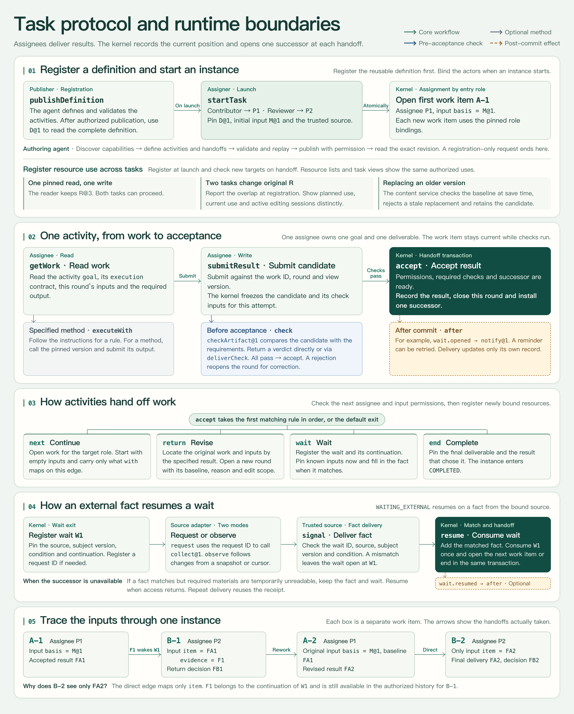

# 任务系统协议与运行边界

[English](protocol-and-runtime-boundaries.md) · 简体中文

**详细设计 · 2026-11-20 · 供产品、服务端、接入方和测试共同评审**

**一个活动由一位执行者对一份交付负责。任务系统接纳交付，同时决定下一步。** 多个活动通过交接规则组成一个任务实例。任何时刻，都能从实例读出当前待办、正在等待的事实，或最终交付及其结束依据。

[可移植协议与 Agent 编排](../README.zh-CN.md) · [启动与角色](#activation) · [活动定义](#definition) · [上下文](#context) · [跨任务资料登记](#resource-usage) · [状态转移](#transitions) · [角色接口](#interfaces) · [外部等待](#external) · [存储与接入](#storage) · [推演与验收](#trace)

<a id="architecture"></a>

## 1. 系统构成与写入权



从上往下读，`startTask` 固定角色绑定并登记已知资料用途，`accept` 接纳成果并选定出口，`resume` 按匹配事实消费等待。底行对照了同一活动两次收到的输入。绿色为核心流程，灰色为可选执行方法，蓝色为接纳前检查，金色虚线为事务提交后的副作用。下载本仓库后可[打开交互图](assets/task-system-core-protocol.html)，在图中切换中英文 · [查看高清原图](assets/task-system-core-protocol.png)

| 参与方 | 可写入的事实 | 交给下一方的内容 |
| --- | --- | --- |
| 定义发布方 | 已发布的活动、交接规则和方法版本 | 实例启动时绑定一份不可变的定义修订 |
| 执行者（人或 Agent） | 自己的候选内容，或由自己负责的决定 | 用 `submitResult` 交给任务内核 |
| 任务内核 | 待办、正式成果、交接、等待与回执 | 用 `getWork` 提供授权后的实例视图。只有内核写实例位置 |
| 校验方、外部来源 | 校验方写本次检查的判定，外部来源写自己持有的事实 | 前者交给指定尝试，后者通过 `signal` 交给指定等待 |
| 资料与文档服务 | 资料的真实身份、读写授权、实际编辑会话和保存的版本 | 内核登记各任务的用途。原服务合并协作更新，或核对写入基线后保存原件 |
| 事后订阅方 | 自己的通知送达或其他处理记录 | 消费核心事务提交后的事件 |

**协议边界。** 这是纯服务端协议，规定任务服务对调用方提供的操作、数据、权限、状态转移和回执。前端属于应用扩展，卡片、列表和详情页的样式及交互由各应用决定。查看或刷新一份开放待办后，它仍归原执行者。执行者经页面或 Bot 提交成果，都由任务服务核对权限、待办与轮次，接纳后按定义决定下一步。

<a id="definition"></a>

## 2. 活动定义与组合

**每个最小活动有自己的 `goal`。** 外部编排方把任务目标拆成活动，写下每一步要交出的结果、执行约定、输入、输出结构和接纳条件。`assignee` 是责任角色，启动时绑定实际执行者。发布后，任务内核按固定的活动修订开待办。

<a id="activity-execution"></a>

**子目标和执行约定。** `activity.goal: text` 必填，回答“本步要做到什么”。每个新活动定义还须有一份 `activity.execution`，以下二选一。人和 Agent 使用同一份契约。

| 发布时写入 | 执行者从 `getWork` 取得 | 适用场景 |
| --- | --- | --- |
| `{kind:"rule", instructions?:text}` | `work.execution.instructions` 返回已发布的说明，省略时取本活动 `goal` 的原文 | 执行者自行选择工具。像“每项只保留最新版本”这样同时说清目标和规则的话，在 `goal` 写一次即可 |
| `{kind:"method", executeWith:{method,with?}, instructions?:text}` | `work.execution.executeWith` 返回指定的方法版本和本轮已绑定的参数。有补充说明时一并返回 | 需要调用已登记的实现。方法提供方负责实现，本轮执行者负责将结果提交 |

外部编排方生成草稿时可对只给目标的活动填入 `{kind:"rule"}`。发布检查目标非空、执行形式唯一。方法型须能解析指定版本与用途，`with` 只能使用调用前已有的本轮输入 `in` 或定义常量，缺省为空参数。形式矛盾、必需绑定缺失、引用未来输出或未登记的方法均返回 `INVALID_DEFINITION`。希望自动阻断的要求写入 `output` 或 `checks`。只在明确要求验证方法使用时配置[使用证明](#method-use)。

例如，目标为“每个编号只保留最新记录”时，规则型只写 `execution: {kind: rule}`。同一目标如果要求使用目录中的 `clean@2`，可声明 `execution: {kind: method, executeWith: {method: clean@2, with: {records: in.records}}}`，其中 `records` 是本活动声明的输入端口。

**存与取。** `publishDefinition` 将各活动的 `goal` 和 `execution` 随同一个定义修订保存到任务要求中。`startTask` 固定该修订。内核用“实例的定义修订 + 当前待办的 `activityId`”读取原约定，结合该轮冻结的输入生成 `work.goal`、`work.execution`。刷新、异步校验和退回新轮都沿用该实例的修订。改变目标或做法须发布新修订。

`activityId` 是定义中的活动，`workId` 标识它的一次运行，`attemptId` 标识这一轮的一次正式提交尝试。通过接纳后才分配 `resultId`。

下例是任务 D 的可移植定义。首次登记成功后，本文以 D@1 指代它的不可变修订。`1.0` 是协议格式版本。文件声明责任角色和来源槽位 S，实际主体、权限及发布编号由宿主确定。[可校验的文件格式](../definition.schema.json)

```yaml
protocolVersion: "1.0"
taskId: D
goal: 取得复核采用的正式成果，并保留结束依据
roles: [交付者, 复核者]
sources: [S]
start: {input: {basis: ref}, activity: A, with: {basis: start.basis}}
activities:
  A:
    assignee: 交付者
    goal: 交付一个有版本的成果
    execution: {kind: rule}
    input: {basis: ref}
    output: {artifact: ref, needsExternal: bool}
    checks:
      - {id: C, method: checkArtifact@1, criterion: 成果版本须符合本轮要求, mode: async, with: {basis: in.basis, artifact: out.artifact}}
    routes:
      - when: [out.needsExternal, eq, true]
        exit: {wait: externalReady}
      - default: {next: B, with: {item: result}}
  B:
    assignee: 复核者
    goal: 决定采用哪份成果或说明需要修改的内容
    execution: {kind: rule, instructions: 核对本轮成果。需要退回时写明修改理由。}
    input: {item: resultId, "evidence?": factId}
    output: {variants: {return: {reason: text}, finish: {}}}
    routes:
      - when: [out.kind, eq, return]
        exit: {return: A, base: in.item, edit: [artifact, needsExternal], reason: out.reason}
      - default: {end: in.item}
waits:
  externalReady:
    mode: request
    method: collect@1
    source: S
    subject: out.artifact
    semantics: event
    fact: {ready: bool}
    when: [fact.ready, eq, true]
    resume: {next: B, with: {item: result, evidence: factId}}
after: {wait.opened: [notify@1]}
```

**定义的读法。** `ref` 的形状为 `{id, version}`，指向固定的对象版本，`text` 是非空文本，`?` 表示可选输入。`when` 以 `[字段, eq, 常量]` 比较同类型值。参与选路的计算结果必须进入声明过的交付字段并经过接纳校验。`variants` 由输出中的 `kind` 选择，例如 `{"kind":"return","reason":"修订指定字段"}`。映射只读启动输入 `start`、本轮输入 `in`、本轮输出 `out`、本轮正式成果标识 `result` 及已核验的外部事实 `fact/factId`。

**发布规则。** 入口和出口目标必须存在，各条可达路径的输入映射必须满足目标类型。分支按声明顺序取首个命中，最后一条为唯一默认出口。退回须能从输入定位同一实例中由目标活动正式接纳的具体成果，修改范围须属于该活动的输出。校验、等待和事后方法要能按版本和用途解析。任一项不成立即拒绝发布。发布新修订只影响绑定该修订的新实例。

<a id="activation"></a>

### 2.1 发布、启动与角色绑定

| 管理操作 | 调用者与前置条件 | 成功结果 |
| --- | --- | --- |
| `validateDefinition({document,launch?})` | 当前主体可按授权目录检查定义，可附一次启动的参数 | 只读诊断给出字段路径、原因、补救方法及所需能力。分别标明定义是否合法、本次绑定能否启动 |
| `publishDefinition({document,baseDefinition,requestId})` | 获准在目标任务登记定义的主体。内联格式以 `document.taskId` 定位目标，首版预期为空。宿主原有 `{taskId,draftRevision,requestId}` 草稿入口可复用同一个发布者 | 定义、不可变修订及幂等回执一起写入。旧登记基线返回 `STALE_BASE`，草稿本身已改返回 `STALE_DRAFT`。内联发布后保留他人未发布的草稿及其原基线。在途实例沿用原修订 |
| `readDefinition({definition})` | 对该精确修订有查阅权的主体 | 按登记回执读回完整机器定义。没有实例或已发布新版时仍能读原修订，变化的权限以本次读取为准 |
| `startTask({assignmentId,definition,bindings,input,requestId})` | 有权启动该分配的调用者或受托服务。定义已发布且与分配匹配，角色逐项绑定为可指派的 `{kind,id}`，入口输入符合类型及用途权限 | 同事务保存启动依据、创建实例和首轮待办、登记已知资料用途并查重。返回 `{instanceId,definition,startedAtSeq:1,resourceUsage?}`。有重叠时本次响应即含提示，当前进度由 `getWork` 读取 |

登记成功即取得可复用定义。只有授权同时覆盖派发时才接续启动。启动的 `assignmentId` 来自指派方的可信上下文或获权目录。同一次派发指令稳定解析到同一项，实际建立运行分配沿用启动操作的原子性。内联登记与原草稿发布均核对目标任务权限，分别检查定义基线和草稿修订。旧草稿基于其他定义时先处理版本差异。启动的绑定变化或失败沿启动操作处理，保留已登记修订。[Agent 的完整设计与登记流程](../README.zh-CN.md)

D@1 的一次启动可传 `bindings={交付者:{kind:"member",id:"P1"}, 复核者:{kind:"agent",id:"P2"}}`。默认允许同一主体承担两个角色。原要求写明“另一位”或职责须分离时，定义声明 `distinctRoles`。启动前比较获权目录解析后的主体，冲突返回 `INVALID_BINDINGS`，不创建实例。遗漏、重复或未知角色返回 `INVALID_BINDINGS`，初始资料类型错误返回 `INVALID_INPUT`。首次启动所需受信配置暂不可取得时返回 `UNAVAILABLE`。这些失败均不创建实例或待办。内核从受信配置解析 S 的来源身份及用途，与实际角色绑定一起固定。每次开待办都使用这份绑定，重新核验实际主体的当前权限。

启动键为 `(安全域,调用主体,requestId)`，业务唯一键为 `(assignmentId,definition)`。从认证上下文核验分配访问权，已存在的实例还须核验查阅权。先查原键和摘要，同键换内容返回 `KEY_CONFLICT`。已成功启动的重放直接读原回执，沿用当时固定的来源身份。用新请求号命中已有实例时，比较调用方提交的规范化角色绑定与初始输入。相同则把新键、摘要与原实例同事务记为成功回执，任一值不同返回 `START_CONFLICT`。重放已成功的新键也按该键检查内容。启动可以由已有发布或分配流程调用。运行中换绑属于可选扩展，本协议的角色绑定保持到实例结束。

<a id="context"></a>

### 2.2 运行上下文由谁保存、何时复制

| 作用域与所有者 | 固定时机与内容 | 交接或重启时如何取得 |
| --- | --- | --- |
| 实例，由任务内核保存 | 启动时固定定义修订、初始输入值或版本引用、实际角色与来源绑定 | 用 `instanceId` 找启动依据。开后继和退回都从这里取执行者 |
| 待办，由任务内核保存 | 开待办时固定 `workId/round`、执行者、这条边映射出的输入、来源交接、返修基线及范围。目标、执行约定和接纳规则取绑定的活动修订 | 下一位执行者用 `getWork` 读这一轮。每次从空的输入集合应用 `with`，未映射的可选字段缺省 |
| 尝试，由任务内核保存 | 提交时固定规范化的完整候选、来源待办、校验方法版本及其输入 | 重试与迟到回调只定位原 `attemptId`。新候选另开尝试 |
| 等待，由任务内核保存 | 开等待时固定来源、对象及其版本、条件、关联请求或起点、续接映射的已知值 | 恢复时仅补入这份等待所接纳的事实，再构造后继输入 |
| 内容、草稿与权限，由各原服务保存 | 任务保存所引用的版本。草稿只在正式提交时进入候选 | 正文按精确版本及当前权限读取。上轮历史、聊天记录和本地草稿不会自动进入新待办 |

**交付给下一位的条件。** 内核按目标活动的输入类型应用映射。映射 `resultId/factId` 表示交付相应输出或事实结构中声明的字段及其版本引用，只需其中某项时在 `with` 指定该字段。开待办前按目标主体和用途核验这些引用及其实际使用的嵌套资料。已明确映射的引用无法取得时，禁止退回读取“最新版”或上轮同名字段。上游候选本身引用错误，按字段拒绝。候选或外部事实有效、但后继所需资料暂不可交付时，保持原尝试或等待，持久接管后返回 `pending` 并记录原因。恢复时按原版本和当前授权再验。若原服务确认必需版本已永久销毁，停止自动重试，结清尝试为 `invalidated` 或信号为 `not_matched(invalidated)`，保留原位置、原因和管理处置依据。

<a id="resource-usage"></a>

### 2.3 跨任务的资料使用登记

每个实例按 `instanceId` 单独推进。按实例或原件查询资料用途时，服务返回调用者获准查看的资料、关联任务、读写用途和阶段。**任务启动时登记已知目标并立即提示重叠。收到重叠提示后，各实例可继续自己的活动。保存原件时，内容服务核对实际写入条件。**

**声明用途。** 每个已绑定且获准读取的版本化资源自动登记为 `readVersion`，包括从 `resultId/factId` 中按本轮映射展开的资源。额外访问写入活动的 `resourceUses?: [{target,mode}]`。例如 `{"target":"in.basis","mode":"replace"}` 表示将整份替换输入 `basis` 指向的原件。`edit` 要求内容服务支持协作更新，`replace` 要求支持按基线有条件地保存。发布时校验路径、模式和已知能力，实际绑定时核验目标、执行者的当前权限与提供方能力。

若实际目标永久不支持声明的改写，入口必需目标返回 `INVALID_INPUT`，后继目标来自错误候选时按字段拒绝该尝试。候选或事实有效、但其后继永久无法执行时，按第 2.2 节分别结清为 `invalidated` 或 `not_matched(invalidated)`，保留原流程位置并记录不兼容原因。只有暂时无法确认的依赖才进入恢复流程。

| 两个实例对同一目标的用途 | 登记时的反馈 | 写入时的约束 |
| --- | --- | --- |
| 固定版读取 `readVersion` 与另一项读或写，或各自从同一输入生成独立副本 | 可同时进行。列表显示各自绑定的版本，无冲突提示 | 固定版必须仍可按原版本读取。独立副本有自己的对象标识 |
| 实时读取 `readLive` 与实时读取 | 可同时进行，无冲突提示 | 活动若用实时内容作为验收或选路依据，须把实际使用的版本固化到候选 |
| 实时读取与协作编辑 `edit` 或原件替换 `replace` | 提示“本轮查看的原稿可能发生变化” | 要求稳定输入的活动仍按已绑定的版本读取 |
| 协作编辑与协作编辑 | 立即提示双方正在或准备编辑同一原稿，允许继续协作 | 内容服务合并有权提交的编辑增量，业务内容的分歧可由执行者处理 |
| 整份替换与另一项协作编辑或整份替换 | 立即提示改写重叠，保留各自的候选成果 | 原件所有者在同一事务比较当前基线并保存。基线已变时拒绝旧替换 |

**按资料识别。** 内容服务把路径、附件引用或文档入口解析为 `resourceKey=(安全域,内容服务,原件ID)`。版本单列保存，指向同一原件不同版本的写意图仍能相遇。逐对用途判断，同一任务对该原件的固定读取不抵消它同时声明的改写。同名的独立文档各用自己的键。另存新副本以独立对象创建，如果用户选择覆盖已有位置，则由内容服务解析实际目标，并按 `replace` 办理。无法保留历史版本的来源只可申报实时读取，使用固定输入的活动须先取得可重读的快照。

| 时机 | 登记如何变化 |
| --- | --- |
| `startTask` | 与实例、首轮待办一起登记所有已能从启动输入确定的目标。当前待办记为 `current`，已知的后续用途记为 `planned`。条件分支可显示“可能使用”，只预告计划重合。目标尚依赖后续成果时，保留定义声明，等得到真实标识再查 |
| `accept / resume` 开后继，或退回重开 | 在开待办事务以内核的实际输入重新解析。落实计划、登记此前未知的资料并立即查重。关闭上一轮用途，移除本次选路已排除的计划。返修用新的 `workId` 和本轮基线登记。单纯等待释放上一步的用途。若请求型等待委托方法继续使用该资料，按该等待声明的 `resourceUses` 登记到 `waitId/externalRequestId`，可绑定本轮已冻结的 `in/out/result` 引用 |
| 结束、取消、故障恢复 | 清除计划及已关闭待办的用途。普通关闭页面只结束相应编辑会话。对已发出且仍可能写回的受托请求，按第 5 节的原请求终态释放登记。重启按已提交实例和请求恢复，原键重放不新增登记或提醒 |

`planned` 表示预计使用，`current` 表示本轮待办或仍有效的受托请求已经绑定这项用途。只有原文档服务确认有带该 `workId` 或受托请求标识的获权编辑会话时，界面才显示“正在编辑”。多窗口按同一待办聚合，最后一个会话关闭或失效后恢复为“本轮拟编辑”。一次固定版读取可显示“本轮使用第 3 版”。结果未明的受托改写显示“写入待核实”。原服务在实际写入时核对本轮授权与用途，终止后的迟到操作按原键查回执。取消任务后，已经保存的原稿版本仍可追溯。

**一种具体的冲突。** 实例 A 从原稿 R 的第 3 版开始准备替换。实例 B 也登记替换 R，启动回执当场提示该原稿有另一项改写。A 先保存成功，原稿变为第 4 版。B 拿第 3 版提交整份替换时，内容服务按原协议返回版本冲突（如 `VERSION_CONFLICT`），执行端保留可读的 B 草稿或候选。执行者可取回第 4 版核对差异，确认合并后用新的写入请求保存。若该活动只允许从第 3 版改写，则须取得显式绑定新基线的新待办。普通退回沿用原输入，B 的草稿仍可取回。允许交副本的活动也可另存一份，要求改写原件的活动在接纳时核对原件保存回执。

<a id="states"></a>
<a id="transitions"></a>

## 3. 运行状态与交接事务

一个实例只有一个当前位置。条件分支一次选择一个后继，不同实例可独立推进。下式给出完整的位置类型。表中的“开放”和“待接纳”均属于 `ACTIVE`，同一轮的多次提交由 `attemptId` 区分。

```text
ACTIVE / OPEN(workId, round)                当前执行者可提交
ACTIVE / PENDING(workId, round, attemptId)  本次候选已冻结，内核负责处理
WAITING_EXTERNAL(waitId)                    上一步已接纳，等待指定外部事实
COMPLETED(finalResultId, decisionResultId)  最终交付与结束依据均可读回
```

尝试的 `pending` 可结束为 `accepted/rejected/invalidated`，同步提交可直接产生终态。等待从 `open` 到 `consumed` 或 `cancelled`。`pending/not_matched` 是单条信号的处理结论，均保留原等待。

| 当前状态 | 输入与成立条件 | 同一事务必须产生的结果 | 提交后的状态 |
| --- | --- | --- | --- |
| 尚未启动 | 启动已发布定义且指派有效 | 固定修订，建立实例及首轮待办 | 开放 |
| 开放 | 提交候选，输出或同步校验不合格 | 保存本次尝试、拒绝原因及字段路径，无正式成果 | 原待办开放 |
| 开放 | 提交候选，必需检查尚未齐全，或接纳所需依赖暂不可用 | 固定候选、方法版本、在途尝试和可恢复的工作，返回 `pending` | 原待办待接纳 |
| 待接纳 | 本尝试的检查拒绝，或原提交权限已确认撤销 | 结束尝试，分别记 `rejected` 或 `invalidated`，释放待办。重新计算允许动作 | 原待办开放 |
| 待接纳 | 收到部分通过，或检查执行遇到暂时故障 | 保存已有判定或重试依据，由系统继续同一尝试 | 原待办待接纳 |
| 开放或待接纳 | 管理状态允许推进，候选属于当前待办及轮次，待接纳时也匹配当前 `attemptId`，权限、范围、全部必需检查和后继均有效 | **接纳**。固定一份正式成果、关闭本轮、记录所选规则并安装一个出口，写最终回执 | 由下表确定 |
| 外部等待 | 本等待收到可信事实 | 未满足时保存事实处理结论。满足时按第 5 节**恢复**，消费等待与安装后继同事务 | 原等待，或已登记的后继 |
| 任一位置 | 读待办、重放回执、事后提醒送达 | 核心位置不变。终态可读回，已消费等待的后到事件按第 5 节作答 | 原位置 |

| 接纳出口 | 后继位置 | 必须带入的依据 |
| --- | --- | --- |
| `next` | 目标活动的新待办 | 按 `with` 映射输入，解析该活动的执行者 |
| `return` | 指定活动的新待办，该活动轮次加一 | 运行时核对 `base` 为同一实例、同一目标活动的正式成果，按该成果定位原待办，带入原输入、修改范围和理由。范围外的值从原版本继承，并在接纳时校验 |
| `wait` | 一个开放的等待 | 固定来源、对象、条件和续接点。把映射中的 `in/out/result` 绑定到本轮具体版本，只留下 `fact/factId` 待回传填入。需要外部执行时同事务登记关联请求 |
| `end` | 实例结束 | 固定被选为最终交付的成果，以及本轮作出结束决定的成果。两者允许指向同一份交付 |

实例启动后，只有两个动作能把流程交给后继。`accept(attemptId)` 由同步提交或本次最后一项通过的校验触发，接纳本轮成果。`resume(waitId,factId)` 由匹配的 `signal` 触发，消费开放等待。仅当实例仍指向该 `waitId`，且事实归属该等待并满足其冻结条件时，才能消费。恢复器只重试已经持久接管的原动作，执行相同守卫。两者都在安装后继的事务内写下列记录。新 `workId` 表示新的活动轮次，即使执行者相同。补正和校验回传保留原 `workId`。

```text
Transition = {transitionId, instanceId, from, ruleRef, basisRefs, to, appliedSeq}
```

`from/to` 是转移前后的位置，`ruleRef` 指向该定义修订中的出口或续接规则，`basisRefs` 保存实际采用的成果或事实引用。

**事务不变量。** 每份待办最多一份在途候选、最多一份正式成果。每次进入活动都分配新 `workId`，`round` 在本实例的该活动内递增。同轮补正沿用原 `workId/round`。选路是对固定定义和候选字段的纯计算，结果随接纳落库。处于可运行生命周期的实例在完成前恰有一份可定位的待办或开放等待，自然完成后两者均为零。

**版本。** `viewSeq` 启动为 1。冻结为在途、产生当前待办的拒绝或作废结论、正式接纳、消费等待，或管理命令改变本实例的可执行状态，任一事务命中这些情形就加 1，同事务最多加一次。仅更新部分判定、未匹配事实、回执投递或通知时不增序。提交携带最近读到的版本。客户端仅在同一实例及同一授权上下文比较版本。访问许可变更使原缓存和在途读取失效，刷新时只采纳当前授权上下文的最新读取，较晚到达的旧权限响应不能覆盖它。

**管理状态单独核验。** `position` 表示最后一次安装的流程位置。`lifecycle` 从原管理记录读取，与当前访问许可共同决定该位置现在能否操作。临时只读时保留位置和已接管的工作。新写入返回 `LIFECYCLE_BLOCKED`，来源保留未获确认的判定或事件，解禁后按原键处理。正式取消时，管理命令在原事务内使其覆盖的新协议待处理尝试 `invalidated`、开放等待 `cancelled`，并将其已接管的未决事实结清为 `not_matched(invalidated)`。保留原成果和回执。显式重开只恢复管理决定覆盖的分配，建立新一轮待办或新等待编号。已发出的外部请求按原号核实，重新执行须有本次管理决定的依据。旧回传没有重开权限。

<a id="interfaces"></a>
<a id="hooks"></a>

## 4. 角色接口与钩子契约

执行者从授权待办列表或通知取得实例标识。人使用会话身份，Agent 使用绑定用途的执行凭据。两者遵守同一套领取和提交规则。`getWork`、`submitResult` 供执行者使用，`signal` 只授予对应的来源。管理方使用第 2.1 节的发布与启动命令，`accept/resume` 仅由内核调用。问号表示可选字段。

```text
getWork(instanceId, requestId?)
  → {instanceId, definition, viewSeq, lifecycle, position, allowedActions, work?, materials?, receipt?, resourceUsage?}

getResourceUsage(ref | resourceKey)
  → {resourceKey, uses, alerts}

submitResult({instanceId, workId, round, expectedViewSeq, requestId, output, methodReceiptRef?})
  → {requestId, attemptId, outcome}

signal({waitId, eventId, subject, fact, externalRequestId?, sourceVersion?, cursor?})
  → {waitId, eventId, outcome}
```

| 接口 | 有权调用者读到什么 | 结果及其含义 |
| --- | --- | --- |
| `getWork` | `work` 含执行者、目标、输入、输出结构、检查条件、做法、退回范围及最近一次需补正的原因，字段见下方[返回结构](#work-view)。仅有总进度权限时，`position` 只含获准的状态名，省略待办、尝试、等待、成果标识及 `work` | 只读。`allowedActions` 对有权提交的开放待办返回 `[submitResult]`，其余返回空列表。附原 `requestId` 时取本主体、本实例的最新回执，未找到则返回空 |
| `getResourceUsage` | 资料列表和详情读到获准显示的当前用途、计划用途及冲突提示 | 只读。列表按已获权的一页资料批量取相同投影，位置与名称从内容服务取得 |
| `submitResult` | 原操作回执。回执记录这次操作的结论，`getWork` 的位置反映现在轮到谁 | `pending` 内核已接管。终态为 `accepted(resultId,transitionId,appliedSeq)`、`rejected(reason,paths)` 或 `invalidated(reason)` |
| `signal` | 该来源获授权的事件处理回执。关联请求、来源身份与对象均须同本等待一致 | `pending`、`resumed(transitionId)`、`not_matched(reason)`、`already_resumed`。判定顺序见第 5 节 |

**资料登记的读回。** `startTask`、`getWork` 的 `resourceUsage?` 是与本实例相关的授权资料使用列表。资料列表和详情可传入获权资料的原件键或版本引用调用 `getResourceUsage`，均按解析出的原件查当前用途。每项的格式如下。

```text
{resourceKey, uses:[{mode, stage, version?, instanceId?, activityId?, workId?, waitId?, taskLabel?, actorLabel?, editing?, reconciling?}], alerts:[code]}
stage = planned | current
code  = plannedOverlap | liveChanges | sharedWrite
```

合并展示时，实例、计划或本轮归属、资料、用途和绑定版本均须相同。同轮引用的 `R@3` 与 `R@4` 各保留一项。冲突只在不同实例之间计算。第 2.3 节所列读写相遇若含尚未执行的计划，提示 `plannedOverlap`，用“可能”或“计划”表述。已进入待办的实时读遇写提示 `liveChanges`，两项当前改写提示 `sharedWrite`。普通并行读取返回 `alerts:[]`。`version` 为固定读版本或写入基线，`editing:true` 仅来自仍有效的编辑会话。`reconciling:true` 表示受托写入已进入原请求的待核实状态。

只有能查看该资料使用情况的主体可查询共享使用情况。跨任务命中按安全域匹配，显示任务或执行者详情还需相应的查阅权。可知有重叠但无对方详情权限时只返合并后的匿名提示，隐藏对方标识、数量、名称、路径和正文。没有资料使用情况查阅权时，列表省略登记，直接查询返回 `NOT_VISIBLE`。正文继续按原服务的独立授权读取。仅有实例总进度权限时省略 `resourceUsage`。同一启动请求重放仍返回原启动回执，所附用途列表按本次授权刷新。

启动响应直接返回调用者获准查看的用途和冲突提示。进入后继时，新执行者从 `getWork` 取得当前提示。两处提示都无需额外确认。外部来源的 `signal` 回执只含自己的处理结果。

登记事务提交后，订阅方可以通过现有通知机制获知何时重新读取资料用途。派发时按收件人的当前权限核验，只有对其可见的投影发生变化才发送。匿名提示未变或无权获知重叠时不发可观察的刷新事件。按登记操作或交接、资料键、收件主体去重。客户端重新取数，清除已解除的提示，丢弃旧权限或过期请求的响应。对端用途变化不会推进本实例的 `position/viewSeq`。

<a id="work-view"></a>

### 4.1 待办与资料的返回结构

`work` 是本轮要完成的活动，`materials` 展开本次获准读取的内容。问号表示该字段可省略。`workId/round` 由 `position` 提供。下表中的结构和字段含义固定，业务端口由已发布的活动声明。

| `work` 字段 | 类型与取值来源 |
| --- | --- |
| `activityId`、`assignee` | 活动标识和 `{role, actor:{kind,id}}`。角色取定义，实际主体取本轮绑定 |
| `goal`、`execution` | 子目标原文。规则型返回 `{kind:"rule",instructions:text}`。方法型返回 `{kind:"method",executeWith:{method,inputs},instructions?}`。`method` 是固定版本的目录引用，`inputs` 是 `with` 在本轮映射出的获准参数 |
| `inputSchema`、`input` | 前者为已发布的端口类型和可选性，沿用第 2 节的声明格式。后者为本条边实际绑定并获准查看的键值。根据声明区分普通值、`ref`、`resultId` 和 `factId` |
| `output`、`checks` | `output` 为本活动的交付结构，含适用的 `variants`。`checks` 为 `[{id,method,criterion?,provesUse?}]`，无检查时为 `[]`。`criterion` 是对执行者可见的检查要求 |
| `rework?`、`correction?` | 退回新轮时给 `{base,edit,reason}`，分别为原正式成果标识、可改字段路径、退回理由。同轮上一次提交需补正时给 `{reason,paths}`。两者可同时出现 |

| `materials` 字段 | 用哪个键查、能读到什么 |
| --- | --- |
| `results` | `{[resultId]:字段对象}`。取已接纳尝试的正式输出，按这次选取的字段与当前权限投影 |
| `facts` | `{[factId]:字段对象}`。按事实标识定位一条等待事件，返回该等待所声明且调用者有权读的结构字段。正文的两种来源见[事实存储](#fact-body) |
| `resources` | `[{ref:{id,version},read}]`。按同一对 `id,version` 匹配。`read` 是当前主体实际可用的入口，为 `{kind:"link",href}` 或 `{kind:"capability",name}`。前者是内容服务给该身份的认证地址，后者由其受托执行上下文按该版本调用已有能力。两者均复核用途、访问权和所需的内容形式 |

有可见引用时返回 `materials`，其三个容器均有值，空映射用 `{}`，空列表用 `[]`。无可读资料时省略整个 `materials`。只按本轮明确映射的输入、获准的返修基线，或终态获准的最终交付与结束依据展开。嵌套引用以同样规则逐项鉴权并去重。受限的字段、标识、版本、方法参数和读取入口一起过滤。建立后继时核验阅读方实际可用的接口及用途。必需输入失去读取或处理权时撤去 `submitResult`。每次请求以当前主体和用途为准。

`ACTIVE/OPEN` 和 `ACTIVE/PENDING` 可向有待办详情权限者返回同一轮 `work`，待接纳时 `allowedActions=[]`。`WAITING_EXTERNAL` 返回获准的等待位置，`COMPLETED` 返回获准的结束位置与资料，这两种状态均省略 `work`。只有总进度权限时仅披露获准状态，省略 `work`、`materials` 和受限标识。查自己原操作的 `receipt` 沿用同一可见范围。

**B-1 实例。** 下例摘录 P2 获准读取的 `work` 和 `materials`。本例中 P2 有权查看 FA1 的两个输出字段，其受托执行上下文已开放对该资源版本所需的文本读取能力 `resource-read`。适配器按 `ref` 传入原服务的资源标识与精确版本。P2 用 `work.input.evidence` 的值直接索引 `materials.facts`。

```json
{
  "work": {
    "activityId": "B", "assignee": {"role":"复核者","actor":{"kind":"agent","id":"P2"}},
    "goal": "决定采用哪份成果或说明需要修改的内容",
    "execution": {"kind":"rule","instructions":"核对本轮成果。需要退回时写明修改理由。"},
    "inputSchema": {"item":"resultId","evidence?":"factId"},
    "input": {"item":"FA1","evidence":"F1"},
    "output": {"variants":{"return":{"reason":"text"},"finish":{}}}, "checks": []
  },
  "materials": {
    "results":{"FA1":{"artifact":{"id":"asset","version":1},"needsExternal":true}},
    "facts":{"F1":{"ready":true}},
    "resources":[{"ref":{"id":"asset","version":1},"read":{"kind":"capability","name":"resource-read"}}]
  }
}
```

B-2 的顺接仅映射 `item=FA2`。即使同一个 P2 再次读取，`work.input` 也省略 `evidence`，`materials.facts` 为空。历史通过原有授权历史入口按具体工作或交接标识查询。

**退回后的提交。** 普通活动按完整 `output` 校验。返修活动先核验本次用途有权继承或比较的基线字段，再以 `base` 的正式输出为底稿，仅覆盖本次提交的可改字段，再对合成的完整候选运行原规则。未给出的字段沿用旧值，范围外字段只接受与旧值相同的回传，显式清空须符合输出类型。

`position.state` 区分三个全局状态，活动中的 `position.phase` 为 `OPEN` 或 `PENDING`。业务回执用 `outcome.kind` 区分分支，命令层错误只返回 `{error:{code}}`。例如下列三条分别是第 7 节的补正请求、即时回执和最终回执。

```json
[
  {"instanceId":"I1","workId":"A-1","round":1,"expectedViewSeq":2,"requestId":"r2","output":{"artifact":{"id":"asset","version":1},"needsExternal":true}},
  {"requestId":"r2","attemptId":"x2","outcome":{"kind":"pending"}},
  {"requestId":"r2","attemptId":"x2","outcome":{"kind":"accepted","resultId":"FA1","transitionId":"t2","appliedSeq":4}}
]
```

**幂等键与错误顺序。** 提交键为 `(安全域,主体类型,主体ID,requestId)`，信号键为 `(安全域,waitId,可信来源,eventId)`。摘要覆盖规范化的完整请求，包括目标、版本与载荷。相同标识换内容属于冲突。处理顺序如下。

1. 认证、解析请求外层，按实例或来源绑定核验当前可见范围。身份无效返回 `UNAUTHENTICATED`，无权获知对象返回 `NOT_VISIBLE`，外层字段无效返回 `INVALID_ENVELOPE`。
2. 原键同摘要返回原回执的最新结论，原键不同摘要返回 `KEY_CONFLICT`。重放已接纳的提交不要求调用者仍是当前执行者。读取原回执仍受当前权限约束。
3. 对新提交依次核验写权限、管理状态、目标待办与轮次、在途尝试、`expectedViewSeq`。分别返回 `FORBIDDEN`、`LIFECYCLE_BLOCKED`、`STALE_WORK`、`ATTEMPT_BUSY`、`STALE_VIEW`。通过才产生尝试，活动输出缺项按业务拒绝回字段路径。
4. 响应丢失或无法确认本地提交时返回可重试的 `UNAVAILABLE`（若连接仍在）。调用方保留原键和原载荷查回执或重投。收到 `pending` 表示候选或事实及其恢复责任均已持久化，内核负责继续。

### 4.2 方法绑定与检查

**可复用方法的登记契约。** 方法目录按 `methodRef=(id,version)` 固定用途（执行、校验、外部请求或事后处理）、输入与返回类型、允许的调用主体及接入实现。发布时核对绑定用途和 `with` 的类型。`with` 只绑定声明过的业务参数，省略表示空参数。下表所列关联标识由内核填入，引用按该调用的主体和用途授权。

| 绑定位置 | 调用契约 | 对流程的影响 |
| --- | --- | --- |
| 执行者在活动中调用方法 | 方法读获准输入，可以生成有版本的领域产物，再把引用交回调用者 | 本轮执行者继续负责最终提交 |
| 接纳前的检查钩子 | `check({workId,attemptId,checkId,ruleRef,candidateRef,inputs}) → pass 或 reject(reason,paths)`。`inputs` 是从冻结的本轮输入和候选按 `with` 取得的字段，`ruleRef` 指向本轮预期和接纳规则。同步在本次调用返回，异步经受信内部通道 `deliverCheck(attemptId,checkId,candidateRef,deliveryId,verdict)` 回传 | 任一业务拒绝结束本尝试，全部通过才可接纳。技术故障保留同一尝试。外部调用期间释放数据库事务 |
| 等待委托的方法 | `mode=request` 传 `{externalRequestId,waitId,subject,inputs}`，回传依第 5 节调用 `signal` | 交付确认只更新投递记录，匹配事实可触发 `resume` |
| 已提交事件的事后钩子 | 事件携带类型及获准的实例、交接或等待引用。订阅方以 `(eventId,handlerId)` 去重，仅记录自己的处理结果 | 可异步重试。送达、失败或重复处理均不改变核心位置 |

<a id="method-use"></a>

**指定方法的使用证明。** 选择方法与核验其调用是两个声明。需要验证时，在现有 `checks` 中配置一项使用证明。例如 `{id:"use",method:"verifyUse@1",mode:"async",provesUse:["artifact"]}`。发布时要求本活动为方法型、校验方法及其可信凭据读取能力按版本可解析、路径属于已声明输出。`provesUse:[]` 仅核验本轮成功调用。未声明 `provesUse` 的活动沿用普通提交。

1. 执行者通过配置的方法运行，提供方或其受信适配器从已认证上下文绑定安全域、实例、`workId/round`、执行主体与用途、方法版本、本轮映射的输入值或精确版本，以及实际产出。运行成功且结果达到提供方约定的可验状态后，提供方返回定位该记录的 `methodReceiptRef`（不透明标识）。凭据由真实调用产生，早于本次提交的 `attemptId`。
2. 执行端随 `submitResult` 自动带回该标识。内核将它与规范化候选一起冻结，计入请求摘要。它是提交依据，业务输出及下一轮资料按各自的声明投影。提供方按已发布的方法绑定选定，凭据引用本身不授予访问权。
3. 检查方按受信身份读方法目录绑定的提供方原运行记录，核对上项绑定，再逐项对照 `provesUse` 指定的候选字段与实际产出值或版本。判定绑定 `attemptId`、检查和候选版本，走原 `check/deliverCheck`。缺失、确定失配或跨轮复用，返回业务拒绝并开放原待办。凭据读取暂时故障，内核保存原尝试为 `pending` 并恢复。使用权被确认撤销时沿用原作废规则。同键重试沿用原回执，技术故障的恢复无需执行者重新运行方法或手动上传证明。

`after` 可以绑定 `work.accepted`、`wait.opened`、`wait.resumed`、`instance.completed`。事件由已提交的交接派生，`(transitionId,事件类型)` 稳定标识一次发生。

校验回传须匹配已指派的来源、用途、尝试、检查及候选版本。按交付键重放，再按 `(attemptId,checkId)` 取首份有效判定。同检查不同判定返回冲突。已经结束的尝试首次收到其他判定时记为过期。正式接纳时按当前授权核验提交者、资源用途和活动限制，并与撤权操作有确定先后。查权暂不可用时保持待处理，确认撤权才作废。由人或 Agent 独立交出可退回、可追溯的决定时，给它开一份活动待办。

<a id="external"></a>

## 5. 等待的登记、唤醒与恢复

`wait` 阻断这份实例的后继，登记后释放线程。登记事务冻结来源、对象、条件、续接输入和目标。`resume` 可打开活动或结束实例。直接结束时，进入等待的正式成果提供 `decisionResultId`，恢复步骤另存事实依据。

| 等待配置 | 登记事务一起保存 | 来源必须提供的依据 |
| --- | --- | --- |
| `mode=request` | 等待、稳定的 `externalRequestId` 和待投递意图 | 受托结果带相同请求标识和目标对象。外部结果可以早于投递确认到达 |
| `mode=observe` | 等待、对象及建立观察的持久意图 | 状态型来源提供一致的快照及对应游标，快照已匹配即可回传，此后从该游标补读。事件型等待在登记时固定可信起始游标，接收其后的事件 |

`semantics=state` 判断指定对象**已观察到的最新可信状态**。`semantics=event` 判断约定起点之后或关联请求内**发生过的事件**。前者比较来源版本，后者按事件身份及覆盖区间判断。若任务要求条件在接纳瞬间仍然成立，来源须能提供覆盖提交时点的有效凭据或不可撤销事实。来源无法满足所选语义时，拒绝发布该等待。

`signal.fact` 可直接提交符合本等待 `fact` 类型的结构化值。引用不可变内容时，传 `{"$ref":{"id":…, "version":…}}`，最外层的 `$ref` 为保留键。内核按已绑定的内容来源和精确版本取得结构化字段，再校验等待声明的类型与条件。先按已存的等待及来源授权检查查阅权，再执行下表。若 `subject` 绑定版本化对象，回传须匹配冻结的 `{id,version}`。同一对象的 V2 不能顶替 V1。状态型事实必填 `sourceVersion`，用于排列观察到的状态。观察事件必填来源游标，受托结果必填 `externalRequestId`。

| 依次判断 | 本地写入 | 本次返回 |
| --- | --- | --- |
| ① 原事件键已存在 | 同一请求摘要复用回执，不同摘要记冲突 | 原回执最新结论 / `KEY_CONFLICT` |
| ② 新事件的对象或关联请求不符，或事实形状无效 | 拒绝受理，等待不变 | 绑定不符返回 `NOT_VISIBLE`，结构或必填字段不符返回 `INVALID_FACT` |
| ③ 等待已关闭或管理禁行 | 已消费或已取消的等待保留原位置。临时禁行时不接管新事件，来源保留游标 | 已消费返回 `already_resumed`，已取消返回 `not_matched(invalidated)`，临时禁行返回 `LIFECYCLE_BLOCKED` |
| ④ 状态版本早于已记版本，或观察事件未越过起始游标 | 记录原因，保留等待。与已记版本相同但事实摘要不同则记录冲突 | 过期返回 `not_matched(stale)`，等版本矛盾返回 `SOURCE_CONFLICT` |
| ⑤ 可信事实不满足条件 | 记录事实与回执。状态型等待同时保存最新版本和内容摘要 | `not_matched(condition)` |
| ⑥ 匹配，但建立后继的依赖暂不可用 | 持久保存事实、回执和待恢复工作。状态型更新已知版本，等待仍开放 | `pending`。内核恢复时重验条件、权限及当前等待 |
| ⑦ 匹配且后继可建立 | 保存依据、消费等待、安装一个后继并写回执 | `resumed(transitionId)` |

对原键重放，`payload_digest` 比较规范化的完整请求。对新事件的同一状态版本，比较按等待类型解析后的 `fact_digest`。同一组声明字段以结构值或固定引用传入时，状态比较结果相同。引用内容尚未能授权读取、核验或可靠保存时，临时故障返回 `UNAVAILABLE` 并由来源保留原键和游标。内容类型确定不符时返回 `INVALID_FACT`。可信事实已接管但后继暂不可建时，按表中第 ⑥ 项保留原事实并恢复。

同版本同状态的不同事件继续按表中条件判定。新事件和恢复工作均在锁内核对当前实例位置、等待、条件及授权。被较新状态覆盖返回 `not_matched(stale)`，已由其他事件消费返回 `already_resumed`。暂时禁行保留待处理，等待被正式取消或来源授权已撤销时最终记 `not_matched(invalidated)`，对外读取仍须授权。来源只确认已处理或已持久接管的连续游标，同一事实可由两个各自获权的等待分别消费。

投递必要外部请求时使用原请求标识。下游支持幂等就原键重投，只支持查单就先查询，已确认未执行再补投。执行结果无法判定且下游两者均不支持时，保留待核实请求供接入方对账。若请求已发出并仍可能改写原件，即使流程已经恢复或取消，也保留 `waitId/externalRequestId` 的登记并标明“写入待核实”。原服务确认该操作已终结，或已原子阻止它以后写入时，才释放此项。重投和查询原请求均沿用原操作键。可选提醒订阅 `wait.opened`，它的送达记录不参与上述判定。

<a id="storage"></a>
<a id="adoption"></a>

## 6. 数据库设计与现有系统接入

本章是青凝接入说明。其他宿主按相同可观察结果选择存储和事务机制。下表左列是已有实现，右列是新协议的增量设计。所有新行的关联键须落在同一安全域、实例及定义修订内。

| 现有存储与依据 | 新协议改动 |
| --- | --- |
| `task_requirements` 固定发布修订，`task_activity_progress` 对 `(assignment_id,requirement_id)` 唯一。 | 定义增加协议版本。每份已发布活动的 `goal` 和 `execution` 由该 `task_requirements` 修订保存。`progress.id = instanceId`。进度同行增加 `view_seq bigint` 和只写一次的 `start_context`（启动操作、初始输入、角色及可信来源绑定）。启动重放与进度读取共用该记录。沿用 `running/paused/finished` 三个存储值，开放或待接纳由在途尝试派生 |
| `task_activity_steps` 已有步骤序号及来源去重键。整份正式提交使用 `task_submissions`。 | 增加开待办、接纳交接、恢复交接三种步骤。开待办的步骤 ID 作 `workId`。在进入步骤的 `basis_json` 固定来源交接、执行者、输入及返修基线、理由与范围。仅开待办行设 `UNIQUE(progress_id,node_id,round)`。两类交接的步骤 ID 作 `transitionId` |
| `task_operations` 已有主体请求键和摘要。`task_check_slots` 绑定特定检查目标，`task_execution_attempts` 记录工作进程重试。 | 在任务服务增加下列尝试和检查明细。原操作记录保持不可变，按操作 ID 联查尝试回执。正式活动成果从已接纳尝试读出 |
| `task_activity_pauses` 每个进度只允许一个开放等待，`closePause` 按修订消费。 | `pause.id = waitId`。补入冻结的等待规格、请求标识或起始游标、最新来源版本和摘要、投递状态。每个事件的回执存入下列事实明细 |
| 现有文档服务在锁定原稿后持久化协作增量，提交成功再通知编辑者。 | 跨任务用途登记由任务内核保存。原稿身份、编辑会话、实际读写授权及最终内容继续由原服务提供。整份替换须接入原服务的原子版本检查 |
| `task_handoffs` 可持久交付已支持用途，执行端扫描导入，`acceptExecutionResult` 核对来源和输入。实时消息有投递截止条件。 | 受托执行复用已支持的交接。必需的待投递意图随检查或等待落库，恢复器只扫描本地未决记录。可选通知沿用事后事件，外部状态变化由来源推送 |

**新增记录及索引。** 下列为增量设计。`PK` 表示主键，`UQ` 表示唯一索引。候选与外部内容引用均指向不可变版本。

```text
task_activity_attempts
  PK attempt_id → task_operations.id
  work_id, candidate_ref, method_receipt_ref (nullable), status, reason, field_paths, result_id, transition_id
  UQ (work_id) WHERE status = 'pending'
  UQ (work_id) WHERE status = 'accepted'
  UQ (result_id) WHERE result_id IS NOT NULL

task_activity_attempt_checks
  PK (attempt_id, check_id)
  method_version, checker_principal, delivery_key, delivery_state, verdict, verdict_digest

task_activity_wait_events
  PK (company_id, wait_id, source_id, event_id)
  payload_digest, fact_digest, fact_value JSONB, fact_ref JSONB, source_version, source_cursor, outcome, transition_id
  CHECK ((fact_value IS NOT NULL) <> (fact_ref IS NOT NULL))

task_resource_uses                         当前用途，由任务内核写入
  company_id, instance_id, scope_kind, scope_id, port_path, owner_key, object_key, mode, bound_version
  PK (company_id, instance_id, scope_kind, scope_id, port_path, owner_key, object_key, mode)
  INDEX (company_id, owner_key, object_key)
```

<a id="resource-usage-storage"></a>

**登记事务。** `scope_kind/scope_id` 定位定义内的计划、实际待办或受托等待。`plan` 使用带种类的定义节点标识（活动或请求型等待），`work` 使用 `workId`，`wait` 使用 `waitId`。归属须与实例、定义修订及安全域相符。阶段从归属派生。`port_path` 定位实际输入元素，`bound_version` 记录固定读取或整份替换的基线。同一归属按主键幂等登记，已结束用途移出此表，历史依据仍在原活动或请求记录中。登记表只存标识和用途。

启动、选路、释放均在原任务事务中处理。先锁本实例及相关待办或等待，再按锁号固定顺序取得所涉原件的事务级锁（PostgreSQL 可用 `pg_advisory_xact_lock`）。同一完整 `resourceKey` 使用同一锁，首次登记尚无数据行时也生效。在 `READ COMMITTED` 下取得锁之后，更新登记并发起一条新查询，按完整原件键比较其他实例已提交的用途。这样同时首次登记的两个实例中，后取得锁的一方能在成功响应内看到重叠。若使用 `SERIALIZABLE`，须覆盖相同读写集合，序列化失败时以原请求键重试整个事务。

登记锁随事务提交或回滚释放。跨任务提示随原事务写入已有通知投递机制，提交后按第 4 节过滤收件人，回滚不发送。已确定且必须登记的目标暂不可登记时，启动返回 `UNAVAILABLE` 以便用原键重试，交接沿用原尝试或等待的恢复规则。

**原件写入。** 任务登记用于发现相交用途。原操作键重放先核对当前回执查阅权和请求摘要。同键同内容回原保存回执，同键换内容返回 `KEY_CONFLICT`。新请求由内容服务在同一原子操作中核验写权限、目标与 `expectedVersion`，持久化新版本和回执。普通编辑器、协作更新和受托方法每次成功改动原件，都须改变这一可比较的基线。青凝现有文档锁保护本次增量保存。整份替换接入时还须实现“与编辑起点的版本比较后再保存”。不支持有条件替换的提供方不能承接 `replace` 用途。若交付约定允许，执行者仍可交独立副本。开启或回退新登记时仅展示可证实的旧实例用途，不从旧文件名推测历史写意图。空列表也不能代替内容服务的保存校验。

<a id="fact-body"></a>

**事实正文的写入与读回。** 外部来源拥有其业务事实。内核在 `task_activity_wait_events` 中保存本等待实际受理的那一份证据。`factId` 是该行四项主键的稳定不透明引用。不同等待接纳同一来源事件，各自获得一个 `factId`。

| 来源传入 | 唯一正文保存位置 | 读 `materials.facts[F1]` 时 |
| --- | --- | --- |
| `fact: {"ready":true}` | 同一事件行 `fact_value` 保存按已发布类型校验的 JSON 对象，`fact_ref` 为 SQL NULL | 以本轮获准引用 `F1` 定位事件行，在当前权限范围返回 `{"ready":true}` |
| `fact: {"$ref":{"id":"R","version":1}}` | 受信内容服务拥有 R 的固定版本 1，事件行仅保存 `fact_ref={id:"R",version:1}`，`fact_value` 为 SQL NULL | 从绑定的内容服务按原版本与当前权限读取，返回已声明的可见字段。嵌套资源经 `materials.resources` 的认证入口读取 |

首次受理在同一事务写正文或版本引用、摘要和信号回执。消费等待时在同一事务记交接、更新回执并装入后继。事件内容与两个摘要一经登记即固定，后续只更新处理结论及交接引用。错归属或非法载荷按第 5 节拒绝受理。恢复按原行或原版本重验。已固化事实的后继依赖暂不可用时沿用 `pending`，确认所需版本永久销毁时沿用 `not_matched(invalidated)`。

**活动成果和方法依据。** 活动成果用 `result_id` 定位已接纳的尝试。`method_receipt_ref` 只指向方法提供方的原成功记录，校验结论由既有的检查明细保存。接入现有执行服务时可复用其核验成功运行、输入依据和实际资源版本的能力，并由适配器核对新协议的工作与轮次。

`result_id` 和 `transition_id` 在接纳成功时一起写入，其他尝试两列均为空。`round` 按活动计数，独立于旧 `entry_seq`。旧 `revision` 保持等值比较语义。

**事务与恢复。** 同一实例的写入先锁定进度，再锁对应待办、尝试或等待并重验条件。写最终回执与其对应的业务事实同事务提交。若最后一项检查已通过但后继暂不可建，尝试继续在途，已保存的判定足以让恢复器接续。提交前崩溃回到上个完整位置，提交后丢响应可用原键查回执。任务日志记录关联标识和原因，私有内容、权限凭据留在各自的受控存储。

**接口落点。** 青凝现有聊天 Agent 经人类请求保存新的私有任务草稿，人从原卡发布。正式发布还会给贡献者建立或更新分配。接入可移植协议时，在原任务服务内复用定义校验、加锁及不可变修订写入。新协议的单独登记端只产生定义和回执，由独立授权的 `startTask` 发起分配与运行。旧发布入口继续组合原有动作。若向 Agent 开放直接登记，委托须限定安全域、目标和允许动作，审计记录委托人与实际调用者。保留当前所有者校验，不从模型填写的成员身份推导权限。

`getWork` 映射现有工作区和按请求号读取操作，历史沿用 `GET /tasks/:taskId/history`，`submitResult` 在任务动作分派中增加新协议命令。`signal` 接入受信适配器，校验回传接入已绑定用途的执行交付。成员和服务各自认证，统一交给任务服务写进度。

青凝的工作空间资料列表、任务卡和资料详情读取同一份用途登记，按当前权限显示资料位置、关联任务、读写用途和阶段。青凝接入时还须核对冲突解除后各入口都清除相应提示。

现有进入步骤已经保存材料和前序成果快照，实际读取仍检查当前权限。新协议的 `with` 按本次明确映射生成快照。现有取消命令写根生命周期记录并撤销关联委托。第 3 节规定的新协议尝试、等待及修订更新须接入同一管理事务。旧协议仍按原管理依据及重开影响范围处理。

**发布与回退。** 新协议发布入口写入上述活动执行约定。已发布修订及其在途实例沿原处理器读取。旧草稿转为新修订时，已有绑定转成方法型，无指定方法的活动转成规则型，保留原目标与已有做法原文。新的字段和约束按定义版本启用。先部署增量列、约束及能按定义版本分派的读写服务，再允许新定义启动。旧进度、旧 UUID 修订及原生命周期命令沿用原处理器。停止新协议时关闭新实例入口，保留在途实例的处理器、资料登记与释放、回调、未决请求和结果读取，核对每份开放等待直至办结。切换期间同一实例始终由绑定版本的处理器推进。

<a id="trace"></a>

## 7. 协议推演与验收

下表使用 D@1，甲为 P1、乙为 P2，初始资料为 M@1。V1、V2 是成果文件的两个版本，F1 是 W1 的匹配事实。

| 操作 | 位置 / `viewSeq` | 正式成果数 |
| --- | --- | ---: |
| 启动 D@1，甲领取 A | A-1 开放 / 1 | 0 |
| 甲漏交 `artifact`，同步拒绝并给出字段路径 | A-1 开放 / 2 | 0 |
| 甲提交 `{artifact: V1, needsExternal: true}`，检查 C 待回传 | A-1 待接纳 / 3 | 0 |
| C 通过，接纳 FA1，登记 W1 与请求 E1 | 等 W1 / 4 | 1 |
| 提醒送达，S 回传 E1 的 `ready=false` | 等 W1 / 4 | 1 |
| S 回传 E1 的 `ready=true`，随后用原键重放 | B-1 开放 / 5，输入为 `{item:FA1,evidence:F1}` | 1 |
| 乙提交 `{kind: return, reason: 修订成果并重选路径}`，接纳 FB1 | A-2 开放 / 6，输入仍为 `{basis:M@1}`，以 FA1 为返修底稿 | 2 |
| 甲交 V2，`needsExternal=false`，再次等 C | A-2 待接纳 / 7 | 2 |
| C 通过，接纳 FA2，命中默认出口 | B-2 开放 / 8，输入仅有 `{item:FA2}` | 3 |
| 乙提交 `{kind: finish}`，接纳 FB2 | 已结束 / 9，最终交付 FA2，结束依据 FB2 | 4 |

<a id="tests"></a>

### 验收用例

下列为产品实现的验收条件。持久状态、并发、权限与中断用例须经实际身份入口及真实数据库，并读回实例位置、回执和正式成果。

| 用例 | 输入或故障注入 | 必须观测到的结果 |
| --- | --- | --- |
| T01 · 发布 | 默认出口缺失、目标不存在、映射类型不符分别发布，再将有效 D@1 升为 D@2 | 三类错误均拒绝发布。在途实例继续按 D@1 判定 |
| T02–03 · 责任与选路 | 交换甲乙绑定的人与 Agent。让两个有序条件同时命中，再使两者都不命中 | 同接口完成交接。前者只有第一条边，后者只有默认边，后继输入可从来源成果还原 |
| T04–05 · 补正与迟到 | A-1 尝试一被拒，尝试二在途，送达尝试一的迟到通过 | 仍等尝试二。其自身检查通过才产生 FA1，原轮次仅一份正式成果 |
| T06 · 检查回放 | 同检查重发相同判定、改判定、执行器断线 | 重放读原处理结果，冲突保留首份判定，断线由内核继续原尝试 |
| T07 · 提交竞争 | 两请求争同一待办，胜者丢响应，交接后重试原键，再用原键换内容 | 至多一份在途和一份正式成果。仍有查阅权的原执行者得到原回执，换内容获 `KEY_CONFLICT` |
| T08 · 撤权 | 等检查期间撤销提交或资源使用权。用其他主体查原回执 | 尝试作废，零新成果，受限内容不可读。旧授权上下文的缓存不能重新显示内容 |
| T09 · 观察空隙 | 登记时已满足、读快照与订阅间状态改变、断线期间发生一次性事件 | 快照或从固定游标回放可覆盖这三种起点，各自只恢复一次 |
| T10–11 · 信号归属 | 错来源或错对象回传。两条匹配事件并发，同一合法事实另送给第二份获权等待 | 越权无披露。同一等待一份消费记录、一个后继。另一等待可独立消费 |
| T12 · 对外投递 | 必需请求确认丢失，提醒失败，正式结果先于确认到达 | 原请求可查或原键重投。合法结果恢复一次，提醒失败不改变位置。非幂等且结果不明时保留待核实记录 |
| T13 · 部分退回 | 在只允许改 `artifact` 的定义中退回 FA1，试改 `needsExternal` 或用旧 workId 提交 | 越界修改被拒，旧待办过期。有效重交产生新成果，范围外值与原版本一致 |
| T14 · 崩溃 | 在冻结、拒绝、最后一项通过、接纳、消费等待的本地事务提交前后分别中止进程 | 读到上个完整位置或本次完整结果。已持久接管的工作自动恢复，无丢失请求或双后继 |
| T15 · 终态与读权限 | 结束或管理禁行后送旧信号，给客户端送旧视图并撤销权限，再经管理入口重开指定范围 | 禁行期间没有交接。旧回调不能复活已撤销的关联，读者仅能取得当前授权视图 |
| T16 · 整体交付 | 直接经协议接口用第 7 节的输入从 A-1 运行到结束。首次提交前重复读取当前待办 | 两次读取均为 A-1 开放、`viewSeq=1`、零正式成果。完成后有四份正式成果、一个已消费等待、零开放待办，最终交付 FA2、结束依据 FB2 |
| T17 · 回退 | 新旧实例并存时停止新协议启动，让在途检查和回调到达 | 两类实例继续由原处理器推进，旧结果和未决请求能按原标识查回 |
| T18–19 · 接管责任 | 检查通过但后继暂不可建。另在状态型等待使 v11 匹配且已接管，v12 撤销条件后重启 | 前者自动完成一次接纳。后者以 v12 为准，v11 的回执终结为过期，等待继续开放 |
| T20 · 启动绑定 | 漏绑角色，再以两请求号并发同配置启动。分别用已成功的键换输入、全新键换执行者 | 漏绑无实例。两份回执指向同一实例及首轮待办。两种换参分别得到 `KEY_CONFLICT` 和 `START_CONFLICT` |
| T21 · 冻结与恢复 | W1 开放后重启，更改角色目录，并先送 V2、再送绑定的 V1 的事实 | V2 不能恢复 W1。合法 V1 只开一份 B-1，仍属于绑定的 P2，输入为 FA1 和 F1 |
| T22 · 输入隔离 | 按第 7 节执行到 B-2，再读 B-1、A-2 和 B-2 的授权记录 | B-1 有 F1。A-2 使用原 M@1 与 FA1。B-2 只有 FA2，未映射的证据字段缺省 |
| T23 · 部分提交 | 只开放 `artifact` 后提交 `{artifact:V2}`，观察校验输入 | 完整候选继承 FA1 的 `needsExternal`。C 按 `with` 只读 M@1 与 V2。越界修改依 T13 拒绝，欠缺原值访问权时不得透露比较结果 |
| T24 · 后继可执行 | W1 收到匹配事实但 P2 暂无资料使用权，随后授权。另测来源确认必需版本永久销毁 | 前者先 `pending`，授权后仅开一个能读取固定资料的 B-1。后者终结该信号，保留 W1 及处置原因，零后继 |
| T25 · 方法绑定 | 给校验槽绑定通知方法，再向有效流程重复投递已提交事件 | 错用途在发布时拒绝。事后处理按事件和处理器去重，实例位置、轮次及正式成果数保持一致 |
| T26 · 子目标与执行约定 | 发布 A 规则型只写目标，B 规则型另给说明。让人和 Agent 分别读同一修订，再发布改文的新修订并退回旧实例 | A 从 `work.execution.instructions` 读到自身目标原文，B 读到已发布的独立说明。旧实例刷新、返修和新实例分别按绑定修订读回。新定义缺目标、缺执行形式或引用不可用方法时发布失败 |
| T27 · 资料读取 | 读 B-1、返修 A-2、顺接 B-2、结束视图，再分别以总进度权限和已撤资源权限读取 | F1 仅在挂入该输入的 B-1 本轮以 `materials.facts[F1]` 读回。返修按获权基线，终态按获权最终交付与决定。撤权后敏感嵌套标识、正文、认证地址一起移除，必需资料失权时清除提交动作 |
| T28 · 正文重启与重放 | 在仍开放的状态等待中先传结构值 `ready=false`，再用新事件键及同一来源版本传内容等价的固定引用。另测匹配后重启、原键重放、原键换载荷、引用暂不可读 | 事件行正文位置二选一。两种方式均按原版本读回。同状态新键仍为 `not_matched(condition)`。原键重放不再交接，原键换内容冲突。暂不能核验的引用不确认游标，恢复后按原键办理 |
| T29 · 使用证明 | 无证明要求时直接交结果。有要求时提交真实成功运行凭据，再分别测缺失、跨轮、方法/输入版本错误、凭据实际产出 V1 却提交 V2，以及提供方临时离线 | 普通提交无需凭据。合法候选通过一次。缺失或错配被拒，原轮可补正。技术故障保留原候选待处理，恢复后续验同一凭据 |
| T30 · 同时启动写同一原件 | 两实例用不同别名同时登记同一个 R 的改写，再以相同请求号重放。另启动一个使用同名独立文档的任务 | 至少后序启动在成功响应中看到重叠，两实例的获权执行者均可读回当前冲突。重放无重复记录和提醒，独立文档无误报 |
| T31 · 读写组合 | A 固定读 R@3，B 编辑 R 并保存第 4 版。另测实时读遇编辑、两个协作编辑、独立副本及同轮双端口读取 R@3/R@4 | A 仍读第 3 版，两个固定版本分别列出。固定读和独立副本无冲突提示，实时读遇写与协作双写均获提示。只有真实编辑会话显示“正在编辑” |
| T32 · 动态分支及释放 | 令后继目标由上一步给出，分别选中、绕开或返回该分支，再测永久不支持替换的目标。让可查单的受托写入仍在途，分别恢复、取消并重启 | 实际绑定即查重，未选分支无占用，退回用新轮标识。永久不兼容的有效事实按失效结清，零后继。所有仍可能写回的已发请求，在原服务确认终态或封止前均可读回用途，之后移除 |
| T33 · 原稿防覆盖 | 两个执行者基于 R@3 准备替换，一路用原编辑器先保存。另测成功但丢回执、同键换内容、撤销回执查阅权后重放 | 旧基线被拒，R 的新内容和第二路草稿均可读回。获权同键重放只返回原版本与回执，不多写一次。换内容返回键冲突，已撤权者看不到原回执 |
| T34 · 隔离与可见性 | 以有双边详情权、仅可知重叠、无资料访问权的身份查询实例与资料用途。增减隐藏的任务，另测提交后、派发前撤权和跨域同名原件 | 前者能定位相关任务，第二种只见获准记录及合并的匿名提示，第三种看不到用途。匿名结果未变或收件人已撤权时零提醒。其他安全域不参与匹配。最后一项可见冲突解除后，两处读回均清除提示 |
| T35 · Agent 根据原话登记 | 给出成果、复核人职责及返修要求，只要求登记。Agent 编制定义，登记后重启进程，按回执读回 | 每项硬要求能定位到活动、字段或交接。精确修订与送审正文一致，零实例、零对外通知 |
| T36 · 格式、依赖与修复 | 把只有等待后才有的 `factId` 放进直接边，修复后再试一个不存在的方法、未知协议版本和无汇总来源的并行要求 | 可修复的错误返回准确字段。能力缺失时不删业务条件，未知格式或无法满足的任务不登记。只缺具体人员时可登记定义，当前启动预案另报不可启动 |
| T37 · 注册并发与回读 | 两个新请求用同一预期修订发布。重放赢家原键，再以旧键改动正文。用尚未启动的老修订和撤权身份分别读回 | 只产生一版。获权者按精确版本读回旧原文，同键改内容冲突。撤权者不能从读回或重放推知存在性 |
| T38 · 发布权与启动权 | 仅有草稿权、仅有登记权、两种权均有的 Agent 分别处理同一条指令。再使启动输入不合法后修正 | 私有草稿、已登记定义、已启动实例三个状态分别可核实。启动失败不撤销已登记定义。获权重试只开一份实例，首位执行者从统一接口读到目标与输入 |
| T39 · 两端一致执行 | 给独立的两个解释端相同定义、输入及三条事件序列。另将活动改名、改变一个分支条件或更换返修基线 | 在语义相同的输入下，待办、等待、逐条回执及最终内容相同。改变条件或基线会产生相应的可观察变化。[测试向量](../conformance.json) |
| T40 · 并行汇总 | 在有受信汇总能力的宿主启动三个独立子实例，重复送一项完成、遗漏一项，再补齐；另试撤权、取消和迟到回传 | 父实例一直等本批次指定槽。三份真实、获权、可追溯的交付齐全后只恢复一次。取消的父等待保留原状态，迟到的或属于其他批次的结果不能推进它 |
| T41 · “另一位”与实际身份 | 原话要求另一位接班人。声明角色分离后，让两个不同显示名解析到同一主体；再绑定不同主体运行 | 同一主体在首份待办前得到 `INVALID_BINDINGS`。不同主体可完成退回和接收。仅登记定义时两种实际身份均无须指定 |
